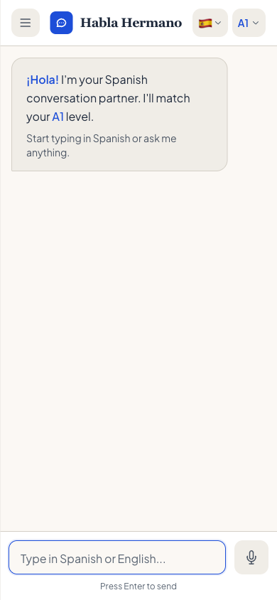
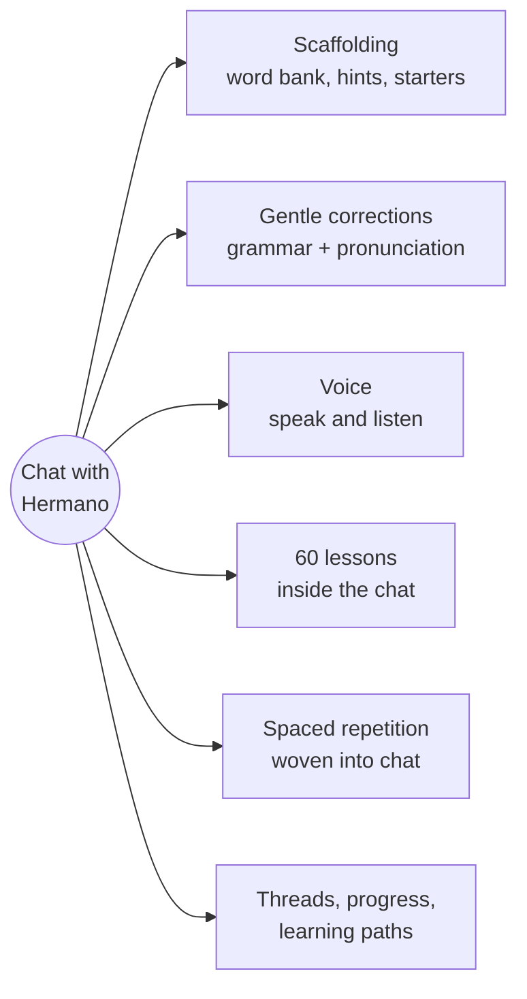
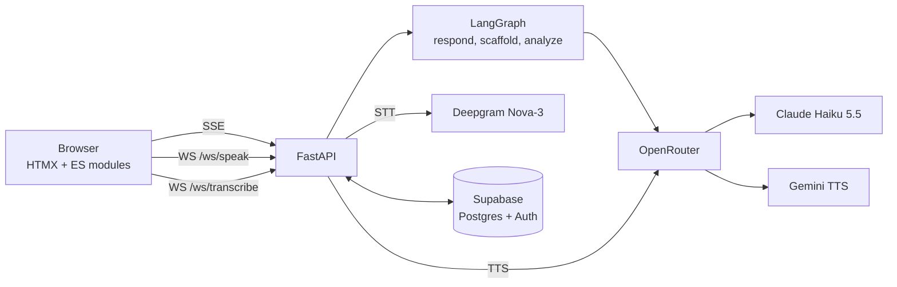

# Habla Hermano

> Your AI conversation partner for Spanish, German, French and Hinglish.

[](https://github.com/darth-dodo/habla-hermano/actions/workflows/ci.yml)
[](https://codecov.io/gh/darth-dodo/habla-hermano)
[](https://github.com/astral-sh/ruff)
[](https://mypy-lang.org/)
[](https://www.python.org/downloads/)

### 🗣️ [Try it live: habla-hermano.onrender.com](https://habla-hermano.onrender.com)

Language apps teach flashcards; people freeze in real conversations. Hermano gets you **talking from message one**, even as a complete beginner, and shifts from mostly English (A0) to almost all target language (B1) as you improve.

<p align="center">
  
  &nbsp;
  
  &nbsp;
  
</p>

## What you get



| Level | Hermano speaks | Help you get |
|---|---|---|
| **A0** complete beginner | 80% English, one new word at a time | word bank and hints open by default, 0.75x voice |
| **A1** beginner | 50 / 50 | word bank and hints, 0.85x voice |
| **A2** elementary | 80% target language | grammar tips on demand |
| **B1** intermediate | 95%+ target language | peer-level corrections |

- **Lessons**: 20 topics x Spanish, German, French, 4 CEFR levels. They run as a guided chat, with multiple choice, fill-in and translation exercises.
- **Voice**: tap the mic to talk (code-switching between English and the target language is fine). Tap play to hear any reply, from 0.75x to 1.5x speed with the pitch kept natural.
- **Review**: SM-2 tracks every word you learn and brings due words back into conversation. No flashcard decks.
- **Guest or account**: chat, feedback and voice work without signing up. An account adds vocabulary tracking, progress charts, multiple threads, password reset and account deletion.
- **Privacy**: conversations and personal fields are encrypted at rest, and row-level security keeps each user's data separate.
- **Five themes**: Azulejo, Terracotta, Flamenco, Sangria, Jardín (all WCAG AA).

<p align="center">
  
  &nbsp;
  
</p>

## How it works



FastAPI renders HTML with Jinja2 and HTMX. Each chat turn runs a LangGraph graph, and the reply streams token by token over SSE. Voice is proxied through FastAPI, so API keys never reach the browser. Details: [docs/architecture.md](docs/architecture.md).

## Run it locally

```bash
git clone https://github.com/darth-dodo/habla-hermano.git && cd habla-hermano
make install
cp .env.example .env   # set OPENROUTER_API_KEY and SECRET_KEY
make dev               # http://localhost:8000
```

Needs Python 3.12+, [uv](https://docs.astral.sh/uv/) and Node 18+. Without Supabase it runs in memory with guest sessions. Add `DEEPGRAM_API_KEY` for the mic. Full setup, migrations and Render deploy: [docs/setup.md](docs/setup.md).

| Command | Does |
|---|---|
| `make dev` | dev server with reload |
| `make test` | pytest (about 2,400 tests, parallel) + Vitest (about 260) |
| `make check` | ruff lint, format check, mypy strict |

## Docs

| Doc | For |
|---|---|
| [Codebase summary](docs/codebase-summary.md) | onboarding: read order, one request end to end, where to change things, gotchas |
| [Architecture](docs/architecture.md) | how every part works, with diagrams |
| [API](docs/api.md) | routes, SSE events, WebSocket protocols |
| [Product](docs/product.md) | pedagogy, the Hermano persona, the A0 to B1 journey |
| [Setup](docs/setup.md) | local setup, Supabase, Render |
| [Testing](docs/testing.md) | running tests, layout, mocking patterns |
| [E2E checklist](docs/playwright-e2e.md) | manual browser flows to verify |
| [Design system](docs/design/design-system.md) | tokens, type, themes |
| [ADRs](docs/adr/) · [phase notes](docs/design/) · [changelog](CHANGELOG.md) | history and decisions |
