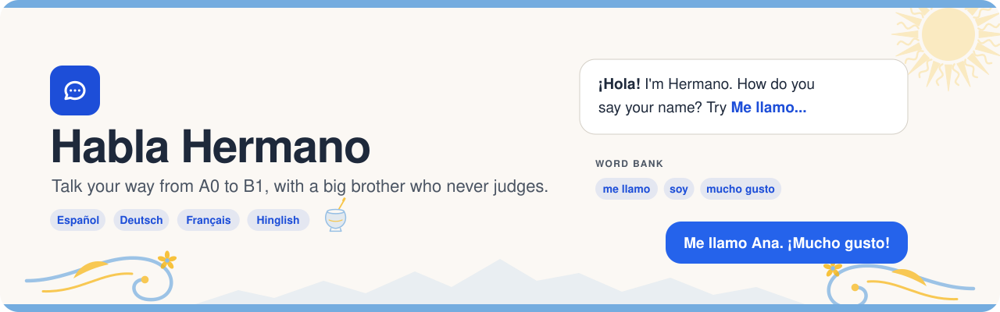
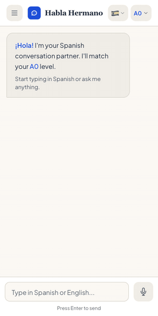
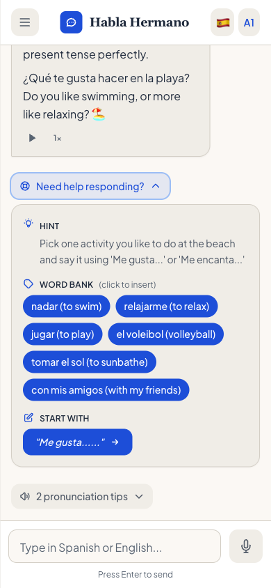
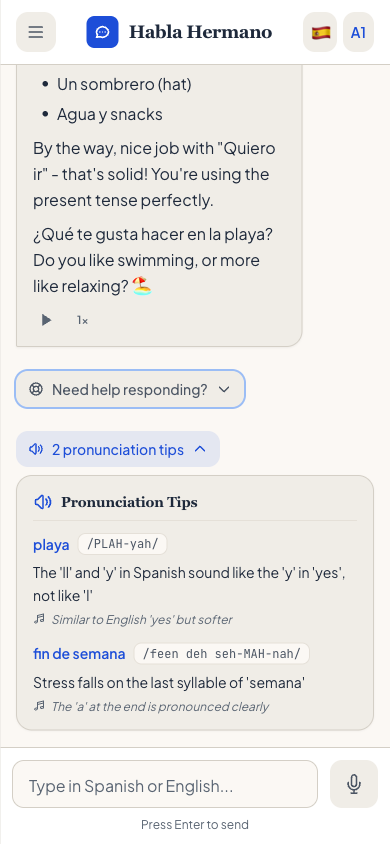
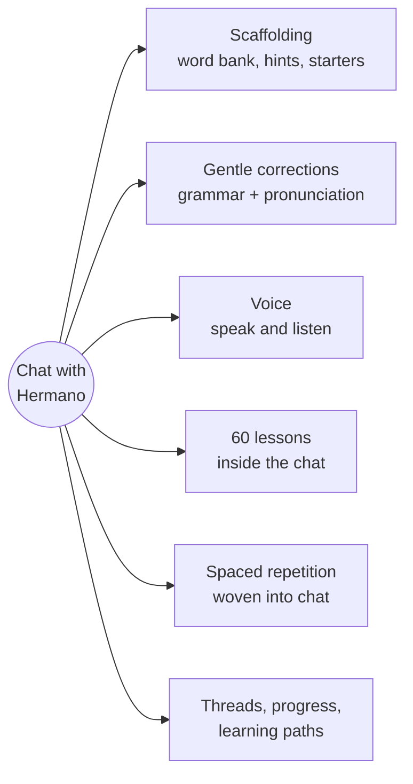
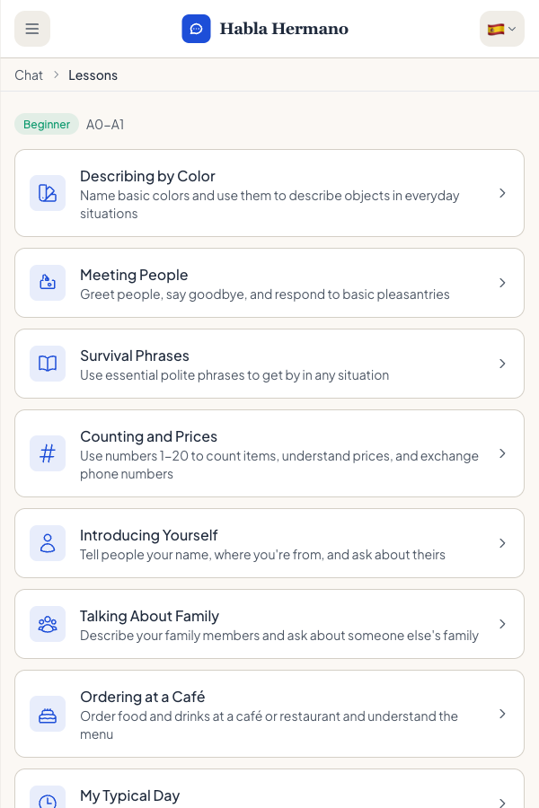
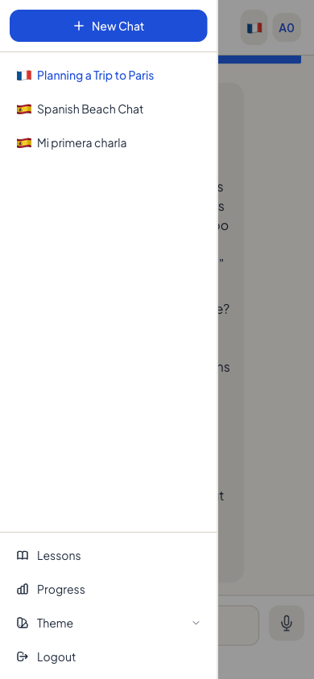
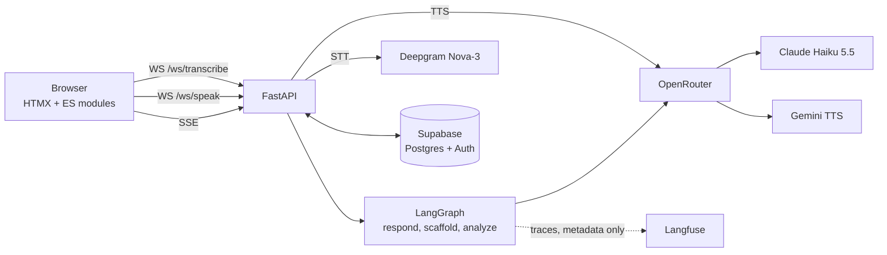

<p align="center">
  <a href="https://habla-hermano.onrender.com">
    
  </a>
</p>

<p align="center">
  <a href="https://habla-hermano.onrender.com"><b>Try it live</b></a>
  &nbsp;&middot;&nbsp;
  <a href="docs/architecture.md">Architecture</a>
  &nbsp;&middot;&nbsp;
  <a href="docs/codebase-summary.md">Codebase tour</a>
  &nbsp;&middot;&nbsp;
  <a href="docs/testing.md#llm-evals">Evals</a>
  &nbsp;&middot;&nbsp;
  <a href="#decisions-and-trade-offs">Decisions</a>
</p>

<p align="center">
  <a href="https://github.com/darth-dodo/habla-hermano/actions/workflows/ci.yml"></a>
  <a href="https://codecov.io/gh/darth-dodo/habla-hermano"></a>
  <a href="docs/testing.md#results"></a>
  <a href="https://habla-hermano.onrender.com"></a>
  <a href="LICENSE"></a>
</p>

Language apps teach flashcards; people freeze in real conversations. Hermano gets you **talking from message one**, even as a complete beginner, and shifts from mostly English (A0) to almost all target language (B1) as you improve.

<p align="center">
  
  &nbsp;
  
  &nbsp;
  
</p>

## What you get



| Level | Hermano speaks | Help you get |
|---|---|---|
| **A0** complete beginner | 80% English, one new word at a time | word bank and hints open by default, 0.75x voice |
| **A1** beginner | 50 / 50 | word bank and hints, 0.85x voice |
| **A2** elementary | 80% target language | grammar tips on demand |
| **B1** intermediate | 95%+ target language | peer-level corrections |

- **Lessons**: 20 topics x Spanish, German, French, 4 CEFR levels. They run as a guided chat, with multiple choice, fill-in and translation exercises.
- **Voice**: tap the mic to talk (code-switching between English and the target language is fine). Tap play to hear any reply, from 0.75x to 1.5x speed with the pitch kept natural.
- **Review**: SM-2 tracks every word you learn and brings due words back into conversation. No flashcard decks.
- **Guest or account**: chat, feedback and voice work without signing up. An account adds vocabulary tracking, progress charts, multiple threads, password reset and account deletion.
- **Privacy**: conversations and personal fields are encrypted at rest, and row-level security keeps each user's data separate.
- **Five themes**: Azulejo, Terracotta, Flamenco, Sangria, Jardín (all WCAG AA).

<p align="center">
  
  &nbsp;
  
</p>

## How it works



FastAPI renders HTML with Jinja2 and HTMX. Each chat turn runs a LangGraph graph, and the reply streams token by token over SSE. Voice is proxied through FastAPI, so API keys never reach the browser.

**How we know it works:** about 2,400 pytest and 260 Vitest tests in CI (90% coverage), plus `make eval`, which runs 20 learner scenarios against the real model and scores the replies ([results](docs/testing.md#results)). The first eval run found that grammar feedback was silently missing in production (#122). Optional Langfuse traces show each graph node's model, tokens, cost and latency, without any message text. Details: [docs/architecture.md](docs/architecture.md).

## Decisions and trade-offs

| Decision | Why | Cost, or when to revisit |
|---|---|---|
| Server-rendered HTML with HTMX, no SPA ([ADR-003](docs/adr/ADR-003-htmx-alpine-frontend.md)) | The server owns all state; one codebase, no client routing or duplicated API layer | Rich client interactivity is harder; voice and streaming still need hand-written ES modules |
| LangGraph with Postgres checkpoints, encrypted by an `EncryptedSerializer` (Fernet) ([ADR-002](docs/adr/ADR-002-langgraph-conversation-engine.md)) | Conversation state survives restarts, and stored chats are unreadable without `SECRET_KEY` | Checkpoints cannot be queried in SQL; there is no key rotation, so changing `SECRET_KEY` makes old checkpoints unreadable |
| OpenRouter for both chat and TTS ([ADR-011](docs/adr/ADR-011-openrouter-for-llm-and-tts.md)) | One key and one bill; models are settings, and provider routing comes for free | One more hop, and a single point of failure for chat and voice |
| Slowed TTS buffered into `<audio>` with `preservesPitch` | Web Audio `playbackRate` drops the pitch, which misleads beginners at 0.75x and 0.85x | Speeds other than 1x wait for the whole clip before playing |
| Per-client-IP rate limits in process memory | No Redis to run or pay for; correct with `--workers 1` on Render | Move to Redis before running a second worker or instance |
| Guests as signed session cookies, served by the admin client scoped to that session | Guests have no Supabase JWT, so RLS cannot identify them | Guest isolation relies on app code filtering by session ID, not on the database |
| Hidden model reasoning turned off (`get_llm()`) | Reasoning tokens counted against `max_tokens` and truncated the structured JSON; off, evals pass 20/20 and turns are about 39% faster | Revisit if a task needs multi-step reasoning: raise `max_tokens` for that profile instead of turning it back on everywhere |
| Langfuse traces are metadata only in production | The privacy page promises learning data is never shared | Debugging a bad reply needs a local `DEBUG=true` run or an eval case, not a production trace |
| Tailwind compiled and vendor JS self-hosted, CSS committed | No CDN script hosts in the CSP; Render's Python runtime has no Node | Rebuild with `npm run build:css` (CI fails on stale CSS); vendor upgrades are manual |

## Run it locally

```bash
git clone https://github.com/darth-dodo/habla-hermano.git && cd habla-hermano
make install && npm install
cp .env.example .env   # set OPENROUTER_API_KEY and SECRET_KEY
make dev               # http://localhost:8000
```

Needs Python 3.12+, [uv](https://docs.astral.sh/uv/) and Node 18+. Without Supabase it runs in memory with guest sessions. Add `DEEPGRAM_API_KEY` for the mic. Full setup, migrations and Render deploy: [docs/setup.md](docs/setup.md).

| Command | Does |
|---|---|
| `make dev` | dev server with reload |
| `make test` | pytest (about 2,400 tests, parallel) + Vitest (about 260) |
| `make check` | ruff lint, format check, mypy strict |
| `make eval` | 20 real-model scenarios, scored (needs `OPENROUTER_API_KEY`, about 1 US cent) |
| `make dev-css` / `npm run build:css` | rebuild Tailwind after changing classes or `tailwind.config.js` |

## Built with

<p>
  
  
  
  
  
  
  
  
  
  
  
</p>
<p>
  
  <a href="https://github.com/astral-sh/ruff"></a>
  <a href="https://mypy-lang.org/"></a>
  <a href="https://github.com/astral-sh/uv"></a>
  
</p>

## Docs

| Doc | For |
|---|---|
| [Codebase summary](docs/codebase-summary.md) | onboarding: read order, one request end to end, where to change things, gotchas |
| [Architecture](docs/architecture.md) | how every part works, with diagrams |
| [API](docs/api.md) | routes, SSE events, WebSocket protocols |
| [Product](docs/product.md) | pedagogy, the Hermano persona, the A0 to B1 journey |
| [Setup](docs/setup.md) | local setup, Supabase, Render |
| [Testing](docs/testing.md) | running tests, layout, mocking patterns |
| [E2E checklist](docs/playwright-e2e.md) | manual browser flows to verify |
| [Design system](docs/design-system.md) | tokens, type, themes |
| [ADRs](docs/adr/) · [phase notes](docs/history/) · [changelog](CHANGELOG.md) | history and decisions |
