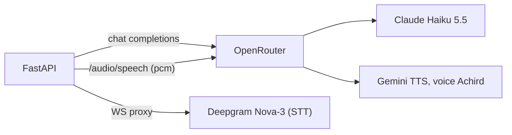

# ADR-011: OpenRouter for the LLM and Text-to-Speech

**Date**: 2026-11-14
**Status**: Accepted (PRs #107, #108, #110, #111)
**Supersedes**: [ADR-008](ADR-008-claude-haiku-model-switch.md), the TTS half of [ADR-010](ADR-010-deepgram-voice-stt-tts.md)

## Decision

All LLM calls and all speech synthesis go through OpenRouter with one key (`OPENROUTER_API_KEY`). Deepgram stays for speech-to-text.

| Part | Before | After |
|---|---|---|
| Chat model | `claude-haiku-4-5` via the Anthropic API | `anthropic/claude-haiku-5.5` via OpenRouter (`ChatOpenAI`) |
| Sampling | `temperature` per profile | none (API version 2026-10-21 rejects it) |
| TTS | Deepgram Aura-2, one voice per language | Gemini TTS, one voice (`Achird`) for every language |
| TTS audio | linear16 from Deepgram | raw 24kHz mono 16-bit PCM, WAV-wrapped in the browser |
| Privacy | Anthropic zero-retention header | `provider.data_collection = "deny"` when `OPENROUTER_ZERO_RETENTION=true` |

## Why

- One key and one bill for text and voice. Models are a setting (`LLM_MODEL`, `TTS_MODEL`), not code.
- Haiku 5.5 costs a tenth of Haiku 4.5 per token on OpenRouter.
- Gemini voices are not tied to a language, so Hermano sounds like the same person in Spanish, German, French and Hinglish.

## Trade-offs

- One more hop, and OpenRouter becomes a single point of failure for both chat and voice.
- Gemini returns PCM only. Slowed playback cannot use Web Audio (its resampling drops the pitch), so speeds other than 1x wait for the full clip and play through `<audio>`.
- Unverified with real traffic: time to first audio, and whether OpenRouter honors the `speed` and `instructions` TTS parameters (we do not send them).
