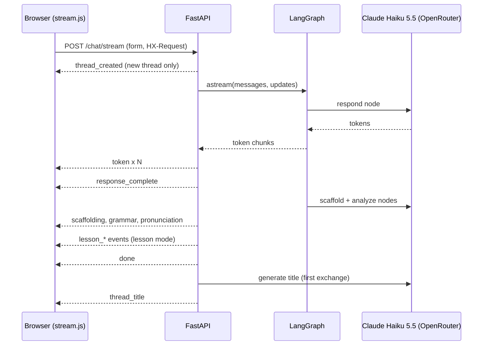
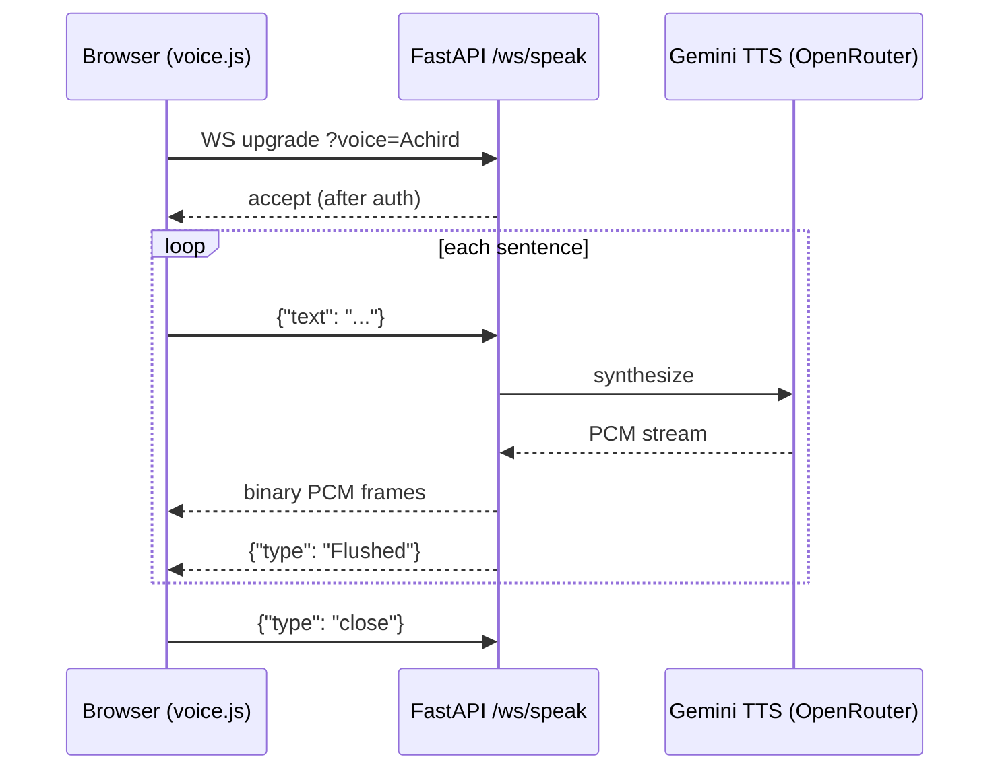

# Habla Hermano API Reference

Habla Hermano is a server-rendered app. Most endpoints return HTML for HTMX to swap in. A few return JSON, one streams SSE, and voice uses WebSockets.

- LLM: Claude Haiku 5.5 via OpenRouter (`LLM_MODEL=anthropic/claude-haiku-5.5`).
- TTS: Gemini TTS via OpenRouter (`google/gemini-3.8-flash-tts`, voice `Achird`), raw 24 kHz 16-bit mono PCM.
- STT: Deepgram Nova-3.

FastAPI's interactive docs are left on (no `docs_url` override in `src/api/main.py`), so `/docs` and `/redoc` list every route and form field. This page covers what `/docs` cannot show: auth, CSRF, streams and socket protocols.

## Conventions

| Topic | Rule |
|---|---|
| Request bodies | HTML form fields (`application/x-www-form-urlencoded`), except `POST /api/speak` (JSON) |
| Languages | `es`, `de`, `fr`, `hi` (`src/validation.py`) |
| Levels | `A0`, `A1`, `A2`, `B1` |
| Message length | 1 to 2000 characters after trimming (chat and TTS) |
| Auth cookie | `sb-access-token` (Supabase JWT, httponly) |
| Guest cookie | `session_id` (signed UUID) |
| Active thread | `active_thread` (signed, set by `POST /threads/select`) |

Auth column legend: **none** (public), **optional** (works for guests, more for logged-in users), **user** (JWT required, 401 otherwise), **login** (redirects to `/auth/login` when logged out), **identity** (JWT or guest session).

### CSRF

`CSRFMiddleware` (`src/api/middleware.py`) rejects every `POST`, `PUT`, `PATCH` and `DELETE` that lacks one of these headers:

- `HX-Request: true` (HTMX sends it)
- `X-Requested-With: XMLHttpRequest` (set it on `fetch`)

Failure is `403 {"detail": "CSRF validation failed"}`. Exempt: `/health` and `/static/*`. WebSockets are not checked (they authenticate on connect instead).

## Endpoints

### Chat (`src/api/routes/chat.py`, `chat_stream.py`)

| Method | Path | Auth | Returns |
|---|---|---|---|
| GET | `/` | optional | Full chat page. Query: `?lesson=<id>`, `?mode=review` |
| GET | `/chat/thread-content` | optional | HTML partial for the active thread, plus `X-Thread-Language` and `X-Thread-Level` headers |
| POST | `/chat` | optional | HTML partial (non-streaming fallback) |
| POST | `/chat/stream` | optional | SSE stream, see below |
| POST | `/new` | optional | Empty body with `HX-Redirect: /` (rotates the conversation) |

### Threads (`/threads`, `src/api/routes/threads.py`)

| Method | Path | Auth | Returns |
|---|---|---|---|
| GET | `/threads/` | user | JSON list of threads |
| POST | `/threads/` | user | 201, JSON thread. Form: `language`, `level` |
| PATCH | `/threads/{thread_id}` | user | JSON thread. Form: `title` |
| DELETE | `/threads/{thread_id}` | user | 204 |
| POST | `/threads/select` | user | `{"status": "ok"}` and sets `active_thread`. Form: `thread_id` |

A thread is `{id, thread_id, title, language, level, created_at, updated_at}`. Unknown thread gives 404.

### Lessons, learning paths, progress, review

| Method | Path | Auth | Returns |
|---|---|---|---|
| GET | `/lessons/` | optional | Lesson list page. Query: `language`, `level` |
| GET | `/learn/` | optional | Learning path page. Query: `language` |
| GET | `/learn/recommendation` | optional | HTML partial (daily suggestion) |
| GET | `/progress/` | login | Dashboard page. Query: `language` |
| GET | `/progress/vocabulary` | optional | HTML partial |
| GET | `/progress/stats` | optional | HTML partial |
| GET | `/progress/chart-data` | optional | JSON `{vocab_growth, accuracy_trend}`. Query: `language`, `days` (default 30). Empty arrays for guests |
| DELETE | `/progress/vocabulary/{word_id}` | optional | HTML partial |
| GET | `/review/stats` | user | JSON `{due_count, next_review_in, total_in_rotation}`. Query: `language` |
| POST | `/review/start` | user | HTML partial. Form: `count` (int or `all`, default 10), `language` |
| POST | `/review/answer` | user | HTML partial. Form: `word_id`, `user_answer`. 400 with no session, 404 unknown word |
| POST | `/review/end` | user | HTML partial (summary) |
| DELETE | `/review/warmup-prompt` | none | Empty HTML (dismisses the prompt) |

### Auth (`/auth`) and privacy (`/privacy`)

| Method | Path | Auth | Returns |
|---|---|---|---|
| GET | `/auth/login`, `/auth/signup` | none | Form pages |
| POST | `/auth/login` | none | HTML; sets `sb-access-token`. Form: `email`, `password` |
| POST | `/auth/signup` | none | HTML. Form: `email`, `password`, `confirm_password` |
| POST | `/auth/logout` | none | Clears cookies |
| GET | `/auth/logout` | none | 302 to `/auth/login` |
| POST | `/auth/clear-stale` | none | Clears stale auth cookies |
| GET, POST | `/auth/forgot-password` | none | Page, then sends a Supabase recovery email. Form: `email` |
| GET, POST | `/auth/reset-password` | none | Page, then sets the new password. Form: `password`, `confirm_password`, `access_token`, `refresh_token` |
| GET | `/privacy/` | optional | Privacy and security page |
| POST | `/privacy/delete-history` | login | Deletes chat history, then `HX-Redirect: /` |
| POST | `/privacy/delete-account` | login | Deletes the account, then `HX-Redirect: /`. Form: `confirm`. 422 if not confirmed, 503 if the backend is unavailable |

### Voice and ops (`src/api/routes/voice.py`, `src/api/main.py`)

| Method | Path | Auth | Returns |
|---|---|---|---|
| WS | `/ws/transcribe` | identity | JSON transcripts, see below |
| WS | `/ws/speak` | identity | Binary PCM frames plus JSON control messages |
| POST | `/api/speak` | none (see note) | `audio/pcm` stream, header `X-Sample-Rate: 24000`. Body: `{"text", "voice"}` |
| GET | `/health` | none | JSON `{status, app, database}`, status is `healthy`, `degraded` or `unhealthy` |
| GET | `/version` | none | JSON `{commit, branch, service}` from Render env vars (null locally) |

Note: `POST /api/speak` takes `EffectiveUserDep` but never checks it, so callers with no JWT and no guest session are not rejected today. `/health` always answers 200, even when its status is `unhealthy`.

## Chat stream (`POST /chat/stream`)

Form fields: `message` (required), `level` (default `A1`), `language` (default `es`), `lesson_id`, `lesson_session`, `thread_id`. With `lesson_id`, the lesson's own level and language win and the lesson chat graph runs instead of the freeform graph.

Every SSE `data` field is JSON.

| Event | Payload | When |
|---|---|---|
| `thread_created` | `{thread_id, language, level}` | First, if a logged-in user had no thread |
| `token` | `{content}` | Each LLM token from the `respond` node |
| `response_complete` | `{content, rendered_html}` | Reply finished (markdown rendered and sanitized) |
| `scaffolding` | `{html}` | Scaffold node enabled it (A0 to A1) |
| `grammar` | `{html}` | Grammar feedback exists |
| `pronunciation` | `{html}` | Pronunciation tips exist |
| `lesson_complete` | `{score, vocab_count, lesson_id}` | Lesson mode, lesson finished |
| `lesson_progress` | lesson UI state object | Lesson mode, every turn |
| `exercise_result` | exercise result object | Lesson mode, an exercise was graded |
| `thread_title` | `{thread_id, title}` | After `done`, freeform only, first exchange of a "New conversation" thread |
| `error` | `{message}` | Validation failure or graph error |
| `done` | `{}` | Graph finished. Validation errors send `error` then `done` |

Validation errors (empty or long message, bad level or language, unknown lesson, thread not owned by the user) come back as an SSE `error` with HTTP 200, not as a 4xx. A graph error sends `error` and ends the stream without `done`. Rate limit (429) and CSRF (403) failures are plain HTTP responses before any stream starts.

## Voice WebSockets

Both sockets authenticate before `accept()`, in this order: `sb-access-token` cookie (verified with Supabase), then the `session_id` cookie, then a signed `?token=` query param (for WebKit browsers that drop httponly cookies on the upgrade). Failure closes with `1008 Authentication required`.

### `/ws/transcribe` (Deepgram Nova-3)

Query: `language` = `es`, `de`, `fr`, `hi` or `multi` (default, code switching).

| Direction | Frame | Content |
|---|---|---|
| Client to server | binary | linear16 PCM, 16 kHz mono |
| Server to client | text JSON | `{"transcript", "is_final", "speech_final"}` |

Close codes: `1008` bad auth or language, `1011` when `DEEPGRAM_API_KEY` is missing or on an internal error. Audio frames are not rate limited per message.

### `/ws/speak` (Gemini TTS)

Query: `voice` (default `Achird`, must be one of the Gemini voices in `ALLOWED_VOICES`, else close `1008`).

| Direction | Frame | Content |
|---|---|---|
| Client to server | text JSON | `{"text": "Hola amigo"}` (1 to 2000 chars after trimming) |
| Server to client | binary | raw PCM, 24 kHz, 16-bit LE, mono |
| Server to client | text JSON | `{"type": "Flushed"}` after each chunk's audio |
| Server to client | text JSON | `{"error": "Invalid text", "code": "INVALID_TEXT"}` |
| Server to client | text JSON | `{"error": "Rate limit exceeded", "code": "RATE_LIMITED"}` |
| Client to server | text JSON | `{"type": "close"}` to end |

Every text message gets exactly one reply (`Flushed` or an error), so the client can wait for it before sending the next chunk. A TTS failure closes with `1011 Speech synthesis failed`, and the browser falls back to `POST /api/speak`.

## Errors

| Status | Cause | Body |
|---|---|---|
| 302 | Login-only page while logged out | Redirect to `/auth/login` |
| 400 | Bad input (review session, TTS voice) | HTML, or JSON `{"detail"}` for `/api/speak` |
| 401 | `user` endpoint without a valid JWT | HTML |
| 403 | Missing CSRF header | JSON `{"detail": "CSRF validation failed"}` |
| 404 | Unknown thread, lesson or word | HTML |
| 422 | Form validation failed | HTML (`errors/400.html`, "Invalid request parameters.") |
| 429 | Rate limit | HTML |
| 502 | `/api/speak` upstream TTS failed | JSON `{"detail": "Speech synthesis failed"}` |
| 500 | Unhandled error (reported to Sentry) | HTML |

For HTMX requests (`HX-Request` header) an `HTTPException` returns its plain `detail` text with the status code, so the page can show it inline. Other requests get the `errors/*.html` templates.

## Rate limits (`src/api/rate_limit.py`)

The REST decorator counts calls **per endpoint for the whole app**, not per user or per IP. One busy user can exhaust the limit for everyone.

| Scope | Limit | Endpoints (each has its own counter) |
|---|---|---|
| Auth | 5 / min | `POST /auth/login`, `/auth/signup`, `/auth/forgot-password`, `/auth/reset-password` |
| Chat | 20 / min | `POST /chat`, `POST /chat/stream` |
| Voice REST | 10 / min | `POST /api/speak` |
| TTS WebSocket | 30 messages / min | Per `/ws/speak` connection (sliding window, replies `RATE_LIMITED`) |

`GENERAL_RATE_LIMIT_CALLS` (60 / min) is defined but not applied to any endpoint.
