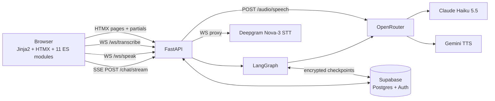
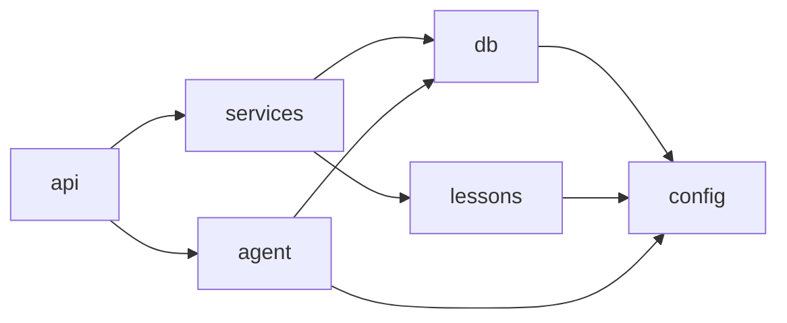
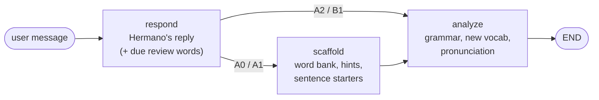
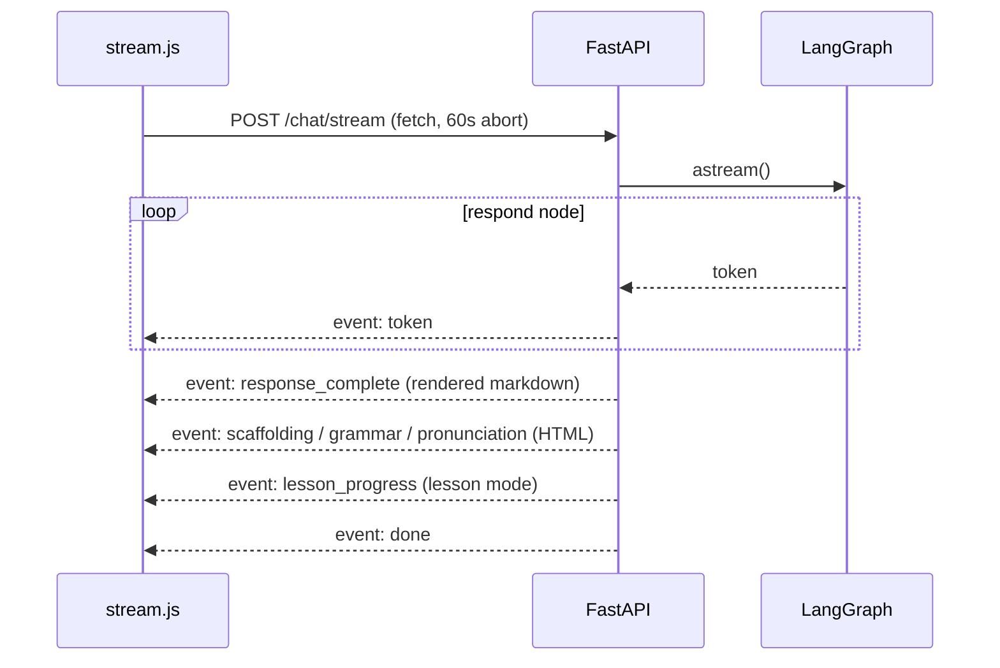
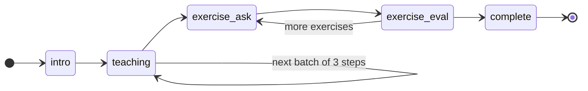
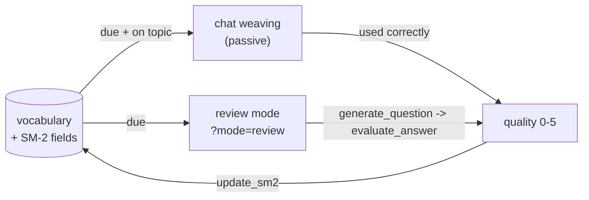
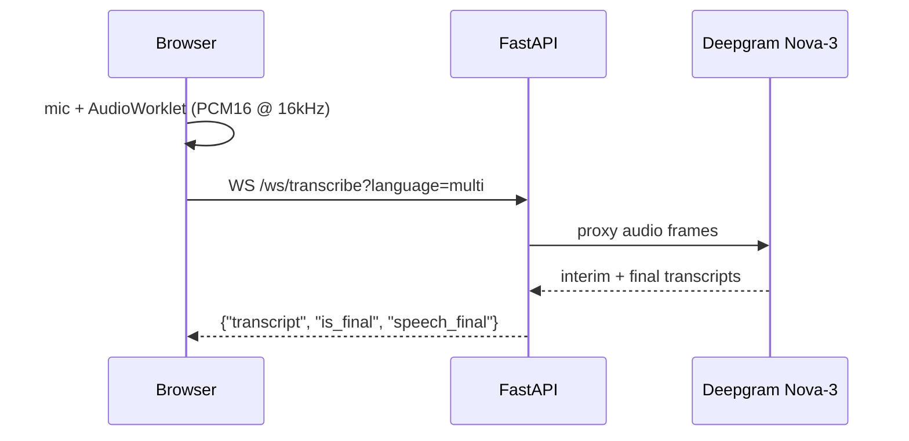
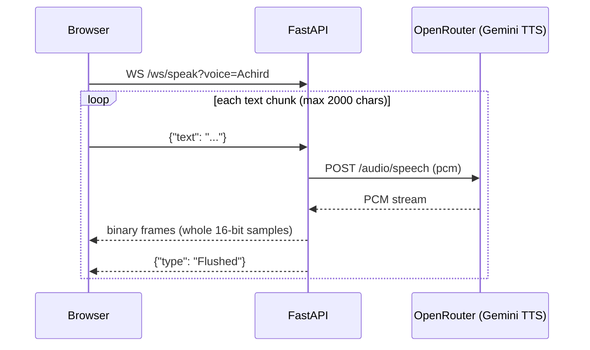
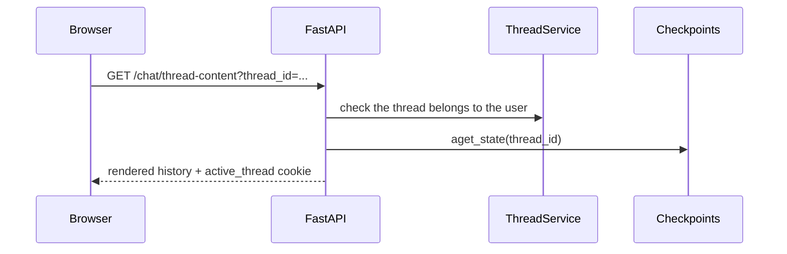

# Architecture

How Habla Hermano works, one diagram per moving part. For endpoints see [api.md](./api.md), for setup see [setup.md](./setup.md).

## At a glance



| Choice | Why |
|---|---|
| Server-rendered HTML + HTMX | No SPA, no client routing. JS only for streaming, voice and small UI bits |
| LangGraph | Stateful graphs with checkpointing, so a conversation or lesson resumes anywhere |
| OpenRouter for chat and TTS | One key, one bill, provider routing with an optional "no data collection" filter |
| Every external call goes through FastAPI | API keys never reach the browser |
| Fernet on all user data at rest | Includes the LangGraph checkpoint blobs, not only PII columns |

## Stack

| Layer | Tech |
|---|---|
| Web | FastAPI, Jinja2, HTMX, Alpine.js, Tailwind |
| Agent | LangGraph, `langchain-openai` `ChatOpenAI` pointed at OpenRouter (`src/agent/llm.py`) |
| LLM | `anthropic/claude-haiku-5.5` (`LLM_MODEL`), no temperature sent |
| Voice | Deepgram Nova-3 STT, Gemini TTS via OpenRouter (`TTS_MODEL`, voice `Achird`) |
| Data | Supabase Postgres + Auth, row-level security; `MemorySaver` when Supabase is not configured |
| Security | Fernet (`cryptography`), `nh3`, `itsdangerous`, nonce CSP |
| Ops | Render (`render.yaml`, deploy hook from CI), Sentry |
| Tests | pytest + xdist, Vitest + jsdom ([testing.md](./testing.md)) |

## Code map

```
src/
├── config.py, validation.py   canonical settings and validators (src/api/* copies are re-export shims)
├── api/        app factory, auth, middleware, SSE streaming, rate limits, routes/
├── agent/      graphs, nodes/, prompts, checkpointer, llm.py
├── services/   business logic: review (SM-2), paths, adaptive, threads, tts.py, ...
├── db/         Supabase client, repositories, models, encryption
├── lessons/    lesson models + YAML loader
├── templates/  Jinja2 pages and HTMX partials
└── static/     CSS, js/modules/*.js, AudioWorklet processor
data/lessons/   20 topic files x 3 languages = 60 lessons
migrations/     SQL, applied by hand in Supabase (see setup.md)
```

Layers only import inward:



## Chat engine

Every chat turn runs this graph (`src/agent/graph.py`):



- **respond** builds a level prompt (`get_prompt_for_level()`) from the Hermano persona plus a per-language adapter (`LANGUAGE_ADAPTER` in `prompts.py`). A new language is a dictionary entry, not new prompt logic.
- **Review weaving** happens inside `respond`: it pulls SM-2 words that are due and on topic, and `analyze` marks the ones the learner used correctly.
- **Checkpoints**: `AsyncPostgresSaver` with an `EncryptedSerializer` in production, `MemorySaver` locally. Thread IDs look like `user:{user_id}:{uuid4}` so the RLS function `checkpoint_owner()` can read the owner without a lookup.

| Level | Language mix | Hermano is |
|---|---|---|
| A0 | 80% English | a supportive big brother, one word at a time |
| A1 | 50 / 50 | a chill friend back from a year abroad |
| A2 | 80% target | playful, starts to challenge you |
| B1 | 95%+ target | a peer in a real conversation |

Hinglish (`hi`) is taught in English and is chat only (no lessons yet).

## Streaming

`POST /chat/stream` runs the graph with `astream(stream_mode=["messages", "updates"])`. Only tokens from `respond` are streamed; the other nodes arrive as whole HTML blocks.



## Lessons

A lesson opens in the normal chat (`/?lesson={id}`) and runs `lesson_chat_graph.py`: the same respond, scaffold, analyze shape, with `lesson_respond` driving a phase machine.



- **Content**: `data/lessons/{level}/{topic}-NNN.yaml`. One file holds shared metadata plus a `languages:` block (`es`, `de`, `fr`) with vocabulary, examples, tips and exercises. A bad language block is skipped and logged; the other languages in the file still load.
- **Grading**: multiple choice by index, fill-blank by normalized match with alternatives, translate by the LLM.
- **Teaching style** per level is injected as `{teaching_adjustments}` (`prompts_lesson_chat.py`).

## Spaced repetition

SM-2 per word (`src/services/review.py`). Words come back in two ways:



```
quality >= 3: reps += 1; interval = 1, 6, then interval x EF
quality <  3: reps = 0;  interval = 1
EF = max(1.3, EF + 0.1 - (5 - q) x (0.08 + (5 - q) x 0.02))
```

## Voice

Voice is optional. STT needs `DEEPGRAM_API_KEY`; TTS uses the required `OPENROUTER_API_KEY`. Both WebSockets authenticate from cookies (or a signed `token` query param for WebKit) before `accept()`, and reject with 1008.

**Speech to text**



**Text to speech** (`src/services/tts.py`, `voice-tts.js`)



| Speed | Playback |
|---|---|
| 1x | Frames play as they arrive through Web Audio (lowest latency) |
| Any other (A0 defaults to 0.75x, A1 to 0.85x) | Frames are collected, wrapped in a WAV and played through `<audio>` with `preservesPitch`, because Web Audio's `playbackRate` drops the pitch when slowed |
| WebSocket fails to connect | Fallback to `POST /api/speak` (raw `audio/pcm`, then WAV in the browser) |

Errors: the server replies `{"error", "code"}` (`RATE_LIMITED`, `INVALID_TEXT`) or closes with 1011; REST answers 502. iOS Safari needs `AudioContext.resume()` on every gesture, and each playback has its own `AbortController` so stale callbacks cannot touch the next one.

## Threads, progress, paths



- **Threads** (accounts only): each has its own language and level. Titles come from the `titling` LLM profile (30 tokens) after the first exchange.
- **Progress**: `ProgressService` reads vocabulary, sessions and lesson progress through `get_supabase_for_user(token)`, so RLS applies. Guests see an empty dashboard and a sign-up prompt.
- **Paths**: 20 lessons per language. `AdaptiveService` suggests the next step from path progress, weak vocabulary categories (under 70%), due reviews and level readiness.

## Security

```
request -> SecurityHeaders -> CSRF -> CORS -> route
```

| Concern | How |
|---|---|
| CSRF | State-changing requests need `HX-Request` or `X-Requested-With` (custom-header pattern) |
| CSP | Nonce-based `script-src`, plus HSTS, frame and content-type headers |
| XSS | `nh3` sanitization and `markupsafe.escape()` |
| Auth | Supabase JWT in httponly cookies; guests get a signed session UUID (`itsdangerous`) |
| Data access | RLS on every table, including the 4 checkpoint tables |
| Encryption | `SECRET_KEY` + `ENCRYPTION_SALT` -> PBKDF2 (480k rounds) -> Fernet. Encrypted: `vocabulary.translation`, `user_profiles.display_name`, every checkpoint blob |
| LLM privacy | `OPENROUTER_ZERO_RETENTION=true` sends `provider.data_collection = "deny"` on chat and TTS calls |
| Rate limits | REST: decorator per endpoint, counted for the whole app (not per user). `/ws/speak`: 30 messages per minute per connection |
| Retention | Checkpoints purged after `CHECKPOINT_RETENTION_DAYS` (30). `CONVERSATION_RETENTION_DAYS` is off by default |
| Account deletion | `POST /privacy/delete-account` removes vocabulary, sessions, lesson progress, threads and checkpoints |

## Frontend modules

| Module | Job |
|---|---|
| `stream.js` | SSE client, streaming bubble, lesson progress |
| `voice.js` | Voice orchestrator, wires the STT and TTS state machines |
| `voice-stt.js` / `voice-tts.js` | Mic capture and transcript; TTS playback paths above |
| `voice-ui.js`, `voice-constants.js` | Voice UI helpers; sample rates, voices, WAV builder, text chunking |
| `fsm.js` | Tiny `createMachine` + `interpret` |
| `dom.js`, `scaffold.js`, `shortcuts.js`, `htmx-handlers.js` | Scrolling and rendering, word bank inserts, keyboard shortcuts, HTMX hooks |

Five themes (Azulejo, Terracotta, Flamenco, Sangria, Jardín) are CSS custom-property sets, WCAG AA. Tokens and type live in [design/design-system.md](./design/design-system.md).

## History

Decisions are in [adr/](./adr/). Per-phase design notes are in [design/](./design/) and are kept as history, not updated. Release history: [CHANGELOG.md](../CHANGELOG.md).
