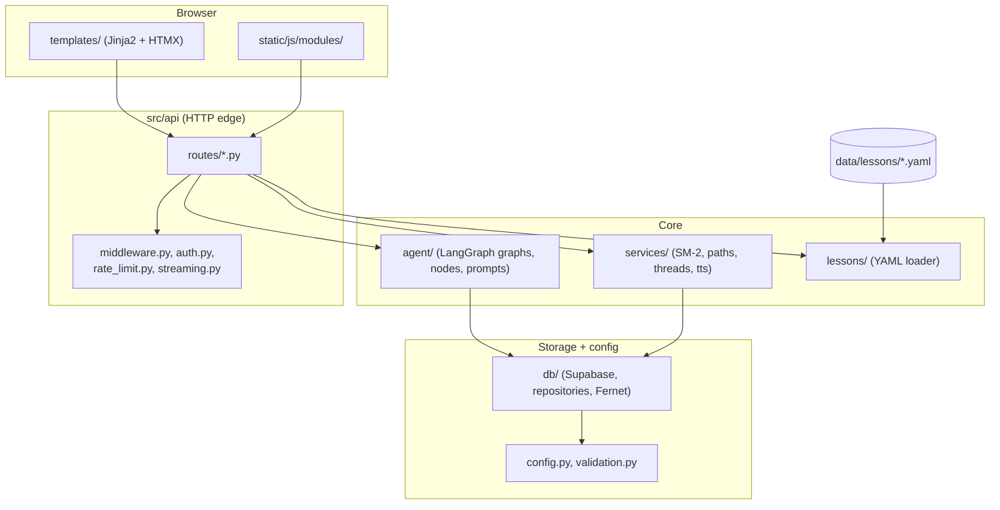
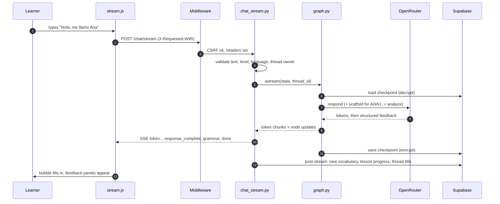
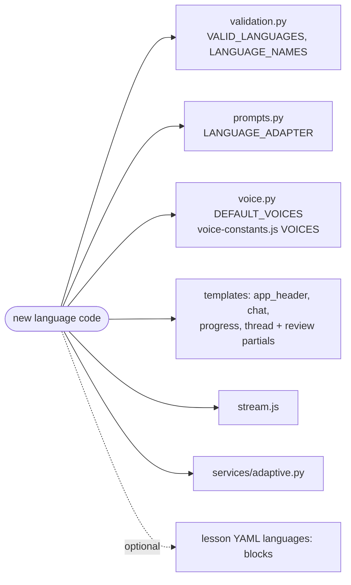

# Codebase Summary

A one-sitting onboarding guide: what to read first, how one message flows through the code, where to make common changes, and the traps. How each part works inside is in [architecture.md](./architecture.md).

## In one picture

## Read in this order

| # | File | Why |
|---|---|---|
| 1 | `src/config.py`, `src/validation.py` | Every setting and the language/level lists everything else uses |
| 2 | `src/api/main.py` | App factory: middleware order, routers, lifespan (checkpointer) |
| 3 | `src/api/routes/chat_stream.py` + `src/api/streaming.py` | The main path: a chat turn as SSE |
| 4 | `src/agent/graph.py` + `nodes/respond.py` | The graph and the node that writes Hermano's reply |
| 5 | `src/agent/prompts.py` | The persona, level prompts and `LANGUAGE_ADAPTER` |
| 6 | `src/static/js/modules/stream.js` | The browser side of the same chat turn |
| 7 | `src/agent/nodes/lesson_chat.py` | The lesson phase machine |
| 8 | `src/api/routes/voice.py` + `src/services/tts.py` | Voice in and out |

## One message, end to end

## Where to change things

| I want to... | Touch |
|---|---|
| Change how Hermano talks at a level | `src/agent/prompts.py` (`get_prompt_for_level`) |
| Change lesson teaching style | `src/agent/prompts_lesson_chat.py` (`TEACHING_ADJUSTMENTS`) |
| Add or edit a lesson | `data/lessons/{level}/{topic}-NNN.yaml`, one `languages:` block per language |
| Add a feedback panel to chat | node in `src/agent/nodes/`, event in `src/api/streaming.py`, partial in `templates/partials/`, handler in `stream.js` |
| Add a page or endpoint | `src/api/routes/<area>.py`, register in `main.py`, template in `src/templates/` |
| Swap the chat or TTS model | `LLM_MODEL` / `TTS_MODEL` env vars (no code) |
| Change the TTS voice | `HERMANO_VOICE` in `voice.py` and `VOICES` in `voice-constants.js` (must match) |
| Tune review scheduling | `src/services/review.py` |
| Add a theme | CSS variables under `[data-theme=...]` in `src/templates/base.html`, see [design-system.md](./design-system.md) |
| Change the database | new SQL file in `migrations/`, applied by hand in Supabase, plus `src/db/repository.py` |

**Adding a language** touches more places than you would guess. Grep for an existing code such as `"fr"`:

## Conventions

| Rule | Detail |
|---|---|
| Canonical modules | Import from `src.config`, `src.validation`, `src.db.client`. The `src/api/` copies are re-export shims |
| Layers import inward | `api -> services/agent -> db -> config`. Never import `src.api` from inner layers |
| LLM calls | Always `get_llm(profile)` from `src/agent/llm.py`. Never pass `temperature`, `top_p` or `top_k` (the API rejects them) |
| User data access | Accounts: `get_supabase_for_user(token)` so RLS applies. Guests have no JWT, so `get_client_for_user()` hands them the admin client: scope every guest query by session ID yourself |
| Encrypted fields | `encrypt_field` / `decrypt_field` live in `db/repository.py` and `services/threads.py`, never in routes |
| Writing style | Docs, comments and commits use no em or en dashes. Conventional commits, feature branches only |

## Gotchas

- **Patch where the name is used**: patch `src.services.tts.get_settings`, not `src.config.get_settings`, when the module did `from src.config import get_settings`.
- **CSRF in tests**: every POST, PUT, PATCH and DELETE needs `CSRF_HEADERS` from `tests/conftest.py`, or you get a 403.
- **Required env in tests**: `OPENROUTER_API_KEY` and `SECRET_KEY` must be set, even to dummy values, or import fails. Dev deps: `uv sync --extra dev`.
- **pytest runs in parallel** (`-n auto`). Use `-n 0` to debug; do not pass `-p no:xdist`.
- **Supabase mocks**: chained calls (`.table().select().eq()`) must return the same mock, and `.not_` needs a `PropertyMock`.
- **`/chat/stream` errors come over SSE** as an `error` event with HTTP 200. Only CSRF (403) and rate limits (429) fail before the stream starts.
- **WebSocket tests**: use `receive_bytes()` / `receive_text()`, not raw `receive()`, which returns the close frame instead of raising.
- **Rate limits are app-wide**, not per user, so tests call `reset_rate_limits()` between cases.
- **iOS Safari audio**: call `AudioContext.resume()` on every tap, and route speeds other than 1x through `<audio>` to keep pitch.

## Glossary

| Term | Meaning |
|---|---|
| Hermano | The tutor persona, a supportive "big brother" |
| A0 to B1 | CEFR levels, complete beginner to intermediate |
| Scaffolding | Word bank, hints and sentence starters for A0/A1 |
| Weaving | Slipping SM-2 review words into normal chat replies |
| Checkpoint | LangGraph's saved conversation state, encrypted in Postgres |
| Thread | One conversation; ID `user:{user_id}:{uuid4}` |
| Guest | No account: a signed session cookie, single conversation |
| Flushed | `/ws/speak` message meaning "this text chunk's audio is done, send the next" |
