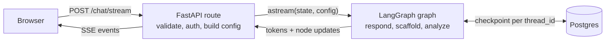
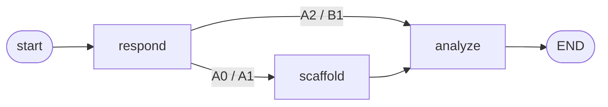
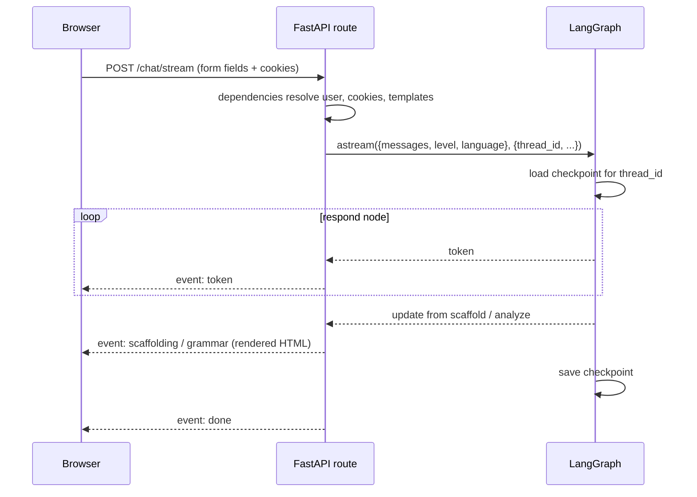

# FastAPI and LangGraph in 5 minutes

The two frameworks this app is built on, explained through its own code. Every snippet points at a real file. Snippets marked *simplified* drop logging and error handling.

## The picture (30 seconds)

**FastAPI** is the web layer: it turns HTTP requests into typed Python function calls. **LangGraph** is the brain: it runs a small graph of steps over a shared, saved state. One chat message touches both:



## FastAPI (2 minutes)

### 1. A route is a typed function

The function signature *is* the API contract. FastAPI reads the type hints, parses the request into them and rejects anything that does not fit, with a 422 before your code runs.

```python
# src/api/routes/chat_stream.py
@router.post(
    "/chat/stream",
    dependencies=[Depends(rate_limit(CHAT_RATE_LIMIT_CALLS, CHAT_RATE_LIMIT_PERIOD))],
)
async def stream_message(
    user: OptionalUserDep,                      # dependency (see 2)
    cookies: ChatCookiesDep,                    # dependency
    message: Annotated[str, Form()],            # form field, required
    level: Annotated[str, Form()] = "A1",       # form field with a default
    language: Annotated[str, Form()] = "es",
) -> EventSourceResponse:
```

### 2. Dependency injection: `Annotated[..., Depends(...)]`

A dependency is a function FastAPI calls for you before the route, and its result is passed in. It is how the app does auth, settings and database clients without globals. Define it once as a type alias, then reuse it anywhere:

```python
# src/api/auth.py
OptionalUserDep = Annotated[AuthenticatedUser | None, Depends(get_current_user_optional)]
EffectiveUserDep = Annotated[EffectiveUser | None, Depends(get_effective_user)]  # account or signed guest
```

Dependencies can depend on other dependencies, run once per request, and are easy to swap in tests with `app.dependency_overrides[get_current_user] = fake`. Route-level `dependencies=[...]` run before the parameters' own, which is why the rate limit sits there: a limited client is refused before the login check calls Supabase.

### 3. Three ways to answer

| Style | Used for | Here |
|---|---|---|
| HTML (Jinja2) | Pages and HTMX partials | `GET /`, `/lessons`, `/progress` (`templates.TemplateResponse`) |
| Server-Sent Events | Streaming a reply token by token | `POST /chat/stream` returns `EventSourceResponse` (`src/api/streaming.py`) |
| WebSocket | Two-way audio | `/ws/transcribe` (speech to text), `/ws/speak` (text to speech) in `src/api/routes/voice.py` |

### 4. Around every request: middleware and lifespan

```
request -> CORS -> CSRF -> SecurityHeaders -> ProxyHeaders -> route        (src/api/main.py, src/api/middleware.py)
```

**Middleware** wraps every request (CSP headers, CSRF check). **Lifespan** runs once at startup and shutdown: here it opens the Postgres checkpointer pool, starts a daily task that deletes idle conversations, and on shutdown closes the pool and flushes Langfuse traces.

## LangGraph (2.5 minutes)

### 1. State: one typed dict, shared by every step

```python
# src/agent/state.py (abridged)
class ConversationState(TypedDict):
    messages: Annotated[list[BaseMessage], add_messages]   # reducer: append, don't replace
    level: str        # A0, A1, A2, B1
    language: str     # es, de, fr, hi
    grammar_feedback: NotRequired[list[GrammarFeedback]]
    scaffolding: NotRequired[dict[str, Any]]
```

The `add_messages` **reducer** is the key idea: when a step returns `{"messages": [reply]}`, LangGraph *appends* it to the history instead of overwriting it. Fields without a reducer are simply replaced.

### 2. Nodes: functions that return a partial update

A node gets the whole state and returns only what it changed. *Simplified:*

```python
# src/agent/nodes/respond.py
async def respond_node(state: ConversationState, config: RunnableConfig) -> dict[str, Any]:
    prompt = get_prompt_for_level(state["language"], state["level"])
    reply = await get_llm("conversational").ainvoke([SystemMessage(prompt), *state["messages"]])
    return {"messages": [reply]}          # appended by add_messages
```

### 3. Edges: fixed or decided at runtime

```python
# src/agent/graph.py
graph = StateGraph(ConversationState)
graph.add_node("respond", respond_node)
graph.add_node("scaffold", scaffold_node)
graph.add_node("analyze", analyze_node)
graph.set_entry_point("respond")
graph.add_conditional_edges("respond", needs_scaffolding,   # a function picks the next node
                            {"scaffold": "scaffold", "analyze": "analyze"})
graph.add_edge("scaffold", "analyze")
graph.add_edge("analyze", END)
```

```python
# src/agent/routing.py
def needs_scaffolding(state: ConversationState) -> Literal["scaffold", "analyze"]:
    return "scaffold" if state["level"] in ["A0", "A1"] else "analyze"
```



### 4. Checkpointer + `thread_id` = memory

Compile the graph with a **checkpointer** and every run saves the state under the `thread_id` you pass. The next message on the same thread starts from the saved history, so routes never store chat history themselves.

```python
graph = build_graph(checkpointer=checkpointer)     # AsyncPostgresSaver in prod, MemorySaver locally
config = {"configurable": {"thread_id": thread_id, "supabase_client": client}}
```

`configurable` also carries **runtime dependencies** (the Supabase client) that nodes read but that are never saved. The same config can carry `callbacks` (Langfuse tracing) and `metadata`.

### 5. Run it: `ainvoke` or `astream`

| Call | Returns | Used by |
|---|---|---|
| `await graph.ainvoke(inputs, config)` | The final state | `POST /chat` (whole reply at once) |
| `graph.astream(inputs, config, stream_mode=["messages", "updates"])` | `messages`: LLM tokens as they arrive. `updates`: each node's partial update when it finishes | `POST /chat/stream`, turned into SSE events |

## How they meet (30 seconds)



## The mental model

| FastAPI | LangGraph |
|---|---|
| Route = typed function | Node = function returning a partial state update |
| Pydantic/type hints validate input | `TypedDict` state, reducers merge updates |
| `Depends()` injects per-request things | `config["configurable"]` injects per-run things |
| Middleware wraps every request | Callbacks (Langfuse) observe every node and LLM call |
| Session cookie identifies the user | `thread_id` identifies the conversation |

## Try it (pick one)

1. **Add a node.** Write `encourage_node` that returns `{"messages": [AIMessage("¡Muy bien!")]}`, wire it with `graph.add_edge("analyze", "encourage")`, and watch it in a `make dev` chat.
2. **Add an endpoint.** In `src/api/routes/`, add `GET /hello` that takes `user: OptionalUserDep` and returns `{"guest": user is None}`. Register the router in `main.py`.
3. **Change behaviour safely.** Edit a level prompt in `src/agent/prompts.py`, then run `make eval` to see whether the 20 scenarios still pass ([testing.md](./testing.md#llm-evals)).

Next: [architecture.md](./architecture.md) for every part of the system, [codebase-summary.md](./codebase-summary.md) for where things live.
