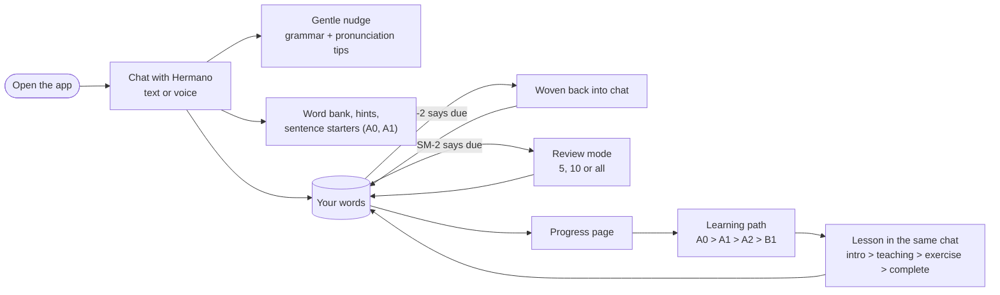

# Habla Hermano Product Spec

> Take someone from zero to conversational in Spanish, German or French. Practice Hinglish along the way.

How it is built lives in [architecture.md](architecture.md). What changed and when lives in [CHANGELOG.md](../CHANGELOG.md).

---

## Vision

Hermano is a friendly language buddy. He takes absolute beginners (A0) to confident intermediate speakers (B1).

Most apps drill vocabulary and grammar in isolation. Hermano gets you talking from day one. The help he gives fades as you improve.

**Core belief**: confidence comes from conversation practice. Words and grammar stick better in context than on flashcards.

### Languages

| Language | Code | Chat | Lessons | Voice |
|----------|------|:----:|:-------:|:-----:|
| Spanish | `es` | Yes | 20 | Yes |
| German | `de` | Yes | 20 | Yes |
| French | `fr` | Yes | 20 | Yes |
| Hinglish (Roman-script Hindi-English, taught in English) | `hi` | Yes | No | Yes |

60 lessons in total, from 20 topic files in `data/lessons/` (5 topics per level, each with an es, de and fr version).

---

## Feature Map



Everything left of "Your words" works for guests. Saving words, review and progress need an account.

---

## The Hermano Personality

Hermano is your supportive big brother. He has been through the journey himself and wants you to succeed.

| Trait | How it shows up |
|-------|-----------------|
| **Patient** | Never rushes, never judges. If you are stuck, he gives the answer and moves on. |
| **Encouraging** | Celebrates every attempt: "Nice!", "You got this!" |
| **Casual** | Talks like he is texting a friend, never like a lecture. |
| **Relatable** | "This one tripped me up at first too." |
| **Warm** | Real enthusiasm when you succeed, not hollow praise. |

His tone shifts with your level: heavy encouragement at A0, a relaxed friend at A1, a gentle challenger at A2, a peer at B1.

```
A0
Hermano: Hey! Let's start with the basics. 'Hola' means 'hello'. Give it a shot!
You:     hola
Hermano: Nice! See, you're already speaking Spanish!

B1
Hermano: ¿Qué piensas de las noticias últimamente?
You:     Creo que es muy complicado...
Hermano: Sí, tienes razón. By the way, 'complejo' works too, with a more nuanced feel.
```

---

## Pedagogy

### Communicative Language Teaching (CLT)

Learn by doing, not by studying rules.

| Principle | What it means here |
|-----------|--------------------|
| **Conversation first** | You talk from the first message. |
| **Meaning over form** | Getting the message across beats perfect grammar. |
| **Implicit correction** | Hermano models the right form without interrupting. |
| **Context** | Words and grammar come from the conversation you are having. |

### The gentle nudge

Hermano answers naturally and slips the correct form into his reply (a recast). A short, expandable tip sits underneath for anyone who wants the rule.

```
You:     Yo soy cansado
Hermano: Ah, ¿estás cansado? Yo también después del trabajo.

         Quick tip: for feelings like tired or hungry, Spanish uses "estar", not "ser".
```

Pronunciation tips work the same way. Hermano weaves them into replies, and a collapsible panel under each reply shows the word, how to say it and a short tip. The panel opens by itself at A0 and stays closed from A1 up.

### What we avoid

- **Grammar-translation**: no memorizing rules, then translating sentences.
- **Drills**: no repeat-after-me loops.
- **Gamification**: no XP, streaks, leaderboards or guilt.
- **Flashcards**: no words out of context.
- **Clinical pronunciation scoring**: voice is for practice, not phoneme grading.

---

## The A0 to B1 Journey

| Level | Target language / English | Scaffolding | Hermano | Speech speed (default) |
|-------|---------------------------|-------------|---------|:----------------------:|
| **A0** First steps | 20% / 80% | Word bank with translations, hints and sentence starters, open by default | One word at a time, celebrates tiny wins | 0.75x |
| **A1** Building blocks | 50% / 50% | Same help, collapsed until you tap it | Simple sentences, models correct forms | 0.85x |
| **A2** Finding your voice | 80% / 20% | None, grammar tips when you slip | Longer exchanges, "here's one locals use" | 1x |
| **B1** Confident conversations | 95%+ / under 5% | None | Natural peer talk, corrections as asides | 1x |

You can change the speech speed on any reply with the speed button next to play.

---

## Spaced Repetition

Words you meet in chat and lessons come back to you through Hermano. No flashcard decks. SM-2 decides **when** a word is due. Hermano decides **how** to bring it back. This needs an account.

| Channel | What happens | How it feels |
|---------|--------------|--------------|
| **Chat weaving** | Hermano works due words into normal replies. Use one well and its schedule updates quietly. | A regular chat. You barely notice the review. |
| **Review mode** | A short quiz in Hermano's voice: translate, fill in the blank, or "what does this mean?" | A quick game with a friend, not a test. |

```
Hermano: ¿Recuerdas la palabra 'mercado'? ¿Qué compras en el mercado?
You:     Yo compro frutas en el mercado.
Hermano: Nice! Sounds like you'd fit right in at a street market.
         (mercado: next review in a few days)
```

**Starting a review**: a warmup prompt at the top of chat when words are due, the review card on the Progress page, or `/?mode=review`. Pick a session size: Quick (5), Regular (10) or All due.

---

## Learning Paths

Each of Spanish, German and French has a 20-lesson path: 4 levels, 5 lessons each. Anyone can browse it. Progress and recommendations need an account.

| Level | Title | Focus |
|-------|-------|-------|
| **A0** | Absolute Beginner | First words and phrases |
| **A1** | Beginner | Basic conversations and introductions |
| **A2** | Elementary | Everyday situations |
| **B1** | Intermediate | Opinions and most situations |

Lessons open in the main chat (`/?lesson={id}`). Hermano walks you through intro, teaching, exercises and completion, with a progress bar. At the end you see your score and a "Continue Path" button. Nothing is locked, so you can jump to any lesson.

The learning page recommends what to do next from four signals:

- **Path progress**: your next unfinished lesson.
- **Weak categories**: topics where your accuracy is below 70%.
- **Review schedule**: words that are due.
- **Level readiness**: you finished every lesson at your level, so try the next one.

---

## Voice

Voice is optional. Text chat always works on its own.

1. Tap the mic and speak. Your words appear live in the input box.
2. Hermano replies in text, streamed as usual.
3. Tap play on his reply to hear it.

| Part | What the learner gets |
|------|-----------------------|
| **Speaking** (Deepgram Nova-3) | Code-switching by default, so mixed English and target language is understood. Handy at A0 and A1. |
| **Listening** (Gemini TTS via OpenRouter) | One warm voice, "Achird", for every language, Hinglish included. Slower by default at lower levels (see the journey table). |

Grammar feedback stays as text, since corrections read better than they sound. The word bank stays on screen. Only Hermano's reply is read aloud.

---

## Guest vs Account

Guests can chat straight away. Their conversation is kept and encrypted at rest. An account unlocks the learning loop.

| Capability | Guest | Account |
|------------|:-----:|:-------:|
| Chat, grammar feedback, pronunciation tips, scaffolding | Yes | Yes |
| Voice (speak and listen) | Yes | Yes |
| Lessons in chat | Yes | Yes, with saved scores |
| Browse learning paths | Yes | Yes |
| Saved vocabulary, progress page, recommendations | No | Yes |
| Spaced repetition and review mode | No | Yes |
| Multiple conversation threads (own language and level, auto titles) | No | Yes |
| Password reset, account deletion | No | Yes |

---

## UX Principles

1. **Never lost**: beginners always have a lifeline (word bank, hint, translation).
2. **Always progressing**: every conversation teaches something, mistakes included.
3. **Conversation first**: every feature exists to get you talking.
4. **Gentle corrections**: errors are learning moments, not failures.
5. **Real progress**: "I can order food in Spanish" beats a 500 XP streak.
6. **Mobile first**: built for one thumb on a phone, with five themes (Azulejo, Terracotta, Flamenco, Sangria, Jardín).

**Who it is for**: beginners who want to speak, not just study, and lapsed learners who never got comfortable talking. The sweet spot is someone nervous about conversation but keen to learn.

---

## What's Next

- Scenario roleplay (ordering food, booking a hotel).
- Offline mode.
