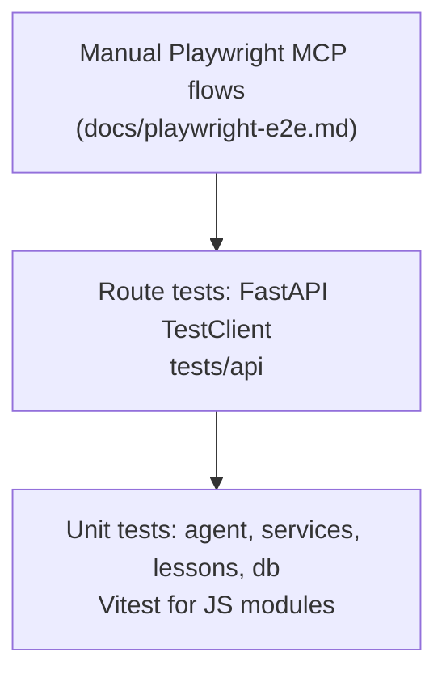
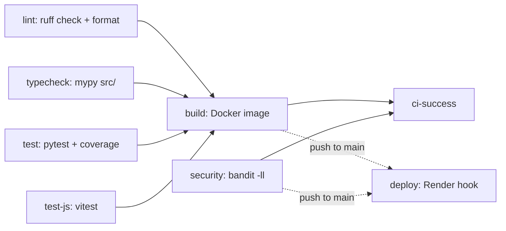

# Testing

How the Habla Hermano test suites are laid out, how to run them, and how they avoid real network calls.

As of 2026-11-14 there are about 2,378 Python tests (pytest) and 257 JS tests (Vitest). Counts drift, so treat them as rough.

## Run the tests

```bash
uv sync --extra dev        # or: make install
make test                  # pytest, then vitest
make test-js               # Vitest only
make test-cov              # pytest with HTML + terminal coverage
make test-fast             # pytest -m "not slow"
make check                 # ruff lint + format check + mypy
```

Notes:

- `pyproject.toml` sets `addopts = -v --tb=short --strict-markers -n auto`. Every pytest run is parallel through pytest-xdist. Add `-n 0` to debug one test serially.
- Markers are strict. Only `slow` and `integration` exist.
- Settings need `OPENROUTER_API_KEY` and `SECRET_KEY`. Any dummy value works. CI sets `test-api-key-for-ci` and `test-secret-key-for-ci`.

```bash
OPENROUTER_API_KEY=x SECRET_KEY=x uv run pytest tests/agent -n 0 -k scaffold
```

## Test pyramid



There is no automated browser suite. Browser checks are the manual flows in [playwright-e2e.md](playwright-e2e.md).

## Layout

| Path | Covers |
|---|---|
| `tests/conftest.py` | Shared fixtures: `CSRF_HEADERS`, `mock_settings`, `mock_supabase`, mocked graph and checkpointer, an app client with the graph mocked. Autouse fixture clears settings, template, rate limit, LLM and graph caches after each test. |
| `tests/agent/` | LangGraph build and routing, state, prompts, review graph, checkpointer and checkpoint purge, LLM zero retention settings |
| `tests/agent/nodes/` | Node logic: respond, scaffold, analyze, review, lesson chat phase machine |
| `tests/api/` | App level concerns: auth, CSRF, security headers, sanitizing, session, SSE streaming, threads API, privacy, persistence, Supabase client |
| `tests/api/routes/` | Per route modules: chat, lessons, learn, progress, review, auth (incl. password reset), validation, voice (STT WebSocket, TTS), plus `test_e2e.py` (multi route coverage tests, not browser tests) |
| `tests/services/` | Business logic: SM-2 review, learning paths, adaptive, levels, progress, vocabulary, threads, thread messages, thread titling, data retention, TTS client |
| `tests/lessons/` | Lesson YAML models and lesson service |
| `tests/db/` | Fernet field encryption, `FernetCipher`, models, repositories with and without encryption |
| `tests/test_rate_limiting.py` | REST and WebSocket rate limits |
| `tests/js/` | Vitest specs for `src/static/js/modules`: dom, fsm, htmx-handlers, scaffold, shortcuts, stream, voice |

## Mocking strategy

No test calls OpenRouter, Gemini, Deepgram or Supabase.

| What | How |
|---|---|
| LLM | Patch `get_llm` in the module that uses it, e.g. `src.agent.nodes.respond.get_llm`, `src.agent.nodes.lesson_chat.get_llm`, `src.services.thread_titling.get_llm`. The client is `ChatOpenAI` pointed at OpenRouter (`src.agent.llm`). |
| Whole graph | `mock_compiled_graph` in `conftest.py` fakes `ainvoke` and `astream` for route and streaming tests. |
| TTS HTTP | `tests/services/test_tts.py` builds an `httpx.AsyncClient` on `httpx.MockTransport`, so it checks the exact request sent. |
| TTS in routes | `FakeSynthesizer` in `tests/api/routes/tts_fakes.py` stands in for `src.services.tts.synthesize_pcm` and records each call. |
| Supabase | `mock_supabase_client` returns a `MagicMock` whose chained PostgREST methods (`table().select().eq()...`) all return the same mock table. `.not_` needs a `PropertyMock` on the type. |
| Auth | Override `get_current_user` / `get_current_user_optional` through FastAPI dependency overrides. |
| CSRF | POST, PUT, PATCH and DELETE need `HX-Request: true`. Use `CSRF_HEADERS` from `tests/conftest.py`. |

Patch where the name is looked up, not where it is defined. Inner layers import from canonical modules, so patch `src.config.get_settings`, not the `src.api.config` shim. The same rule applies to `src.validation` and `src.db.client`.

## JS tests

- Vitest with the `jsdom` environment (`vitest.config.js`).
- Specs live in `tests/js/**/*.test.js` and import the ES modules in `src/static/js/modules/` directly.
- `make test-js` runs once. `make test-js-watch` watches.

## CI

`.github/workflows/ci.yml` runs on pushes to `main` and on PRs, only when `src/`, `tests/`, `data/`, dependency files, the Dockerfile, `render.yaml` or the workflow change.



`ci-success` and `deploy` both wait on all six jobs (the diagram shortens this).

- `test` uploads `coverage.xml` to Codecov (does not fail the build).
- `deploy` only runs on push to `main` and skips if `RENDER_DEPLOY_HOOK_URL` is not set.

## Writing a new test

1. Put it next to its peers in the table above. Python files are `test_*.py`, JS files are `*.test.js`.
2. Reuse `conftest.py` fixtures before adding new ones.
3. Mock the LLM and any HTTP client. A test that needs a real key is a bug.
4. Run the file serially first (`-n 0`), then the full suite.
