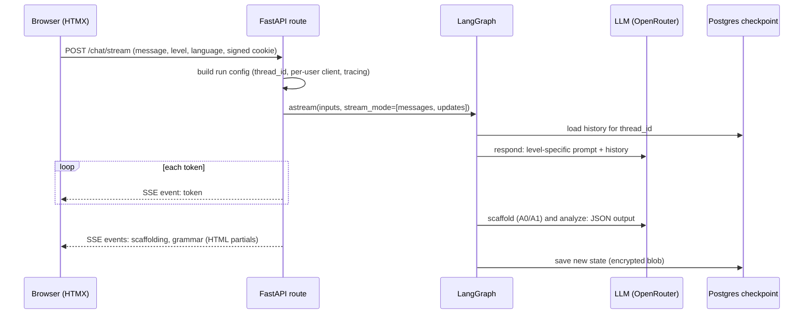
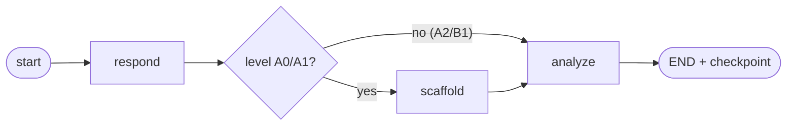
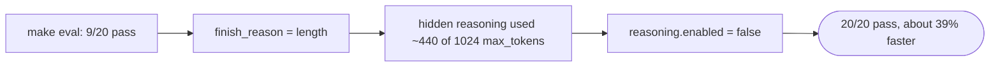

# Walkthrough: one chat message, end to end

Habla Hermano is an AI conversation partner for learners from A0 to B1. This page follows **one chat message** from the browser to the streamed reply. One path shows FastAPI, LangGraph, the LLM, persistence and privacy together.

## Design



The graph itself:



| Node | Does | Code |
|---|---|---|
| respond | Streams Hermano's reply at the learner's level | [respond_node](../../src/agent/nodes/respond.py#L182) |
| routing | A0/A1 get scaffolding, A2/B1 skip it | [needs_scaffolding](../../src/agent/routing.py#L13) |
| scaffold | Word bank, hints, sentence starters (JSON) | [scaffold_node](../../src/agent/nodes/scaffold.py#L159-L186) |
| analyze | Grammar feedback and new vocabulary (JSON) | [analyze_node](../../src/agent/nodes/analyze.py#L346) |

**Key decisions**

- **HTMX + SSE, not React.** The server renders the HTML partials, and the browser only swaps them in. One language, and no client state to keep in sync.
- **LangGraph checkpointer, not a chat table.** Routes never store history. `thread_id` is the only key, so switching and resuming a thread need no extra code.
- **OpenRouter for LLM and TTS.** One key, one bill, zero data retention.
- **Metadata-only tracing.** Langfuse sees node, model, tokens and latency, never learner text.

## Implementation

Call path for one message:

1. [`POST /chat/stream`](../../src/api/routes/chat_stream.py#L98-L112): typed form fields, plus dependencies FastAPI resolves first:
   - [`OptionalUserDep`](../../src/api/auth.py#L421): the account from the JWT cookie, or `None`.
   - [`ChatCookiesDep`](../../src/api/routes/chat.py#L177-L190): the guest ID, only if [its signature is valid](../../src/api/cookies.py#L180-L187).
2. [`_stream_graph`](../../src/api/routes/chat_stream.py#L257-L267) builds the run config with [`_graph_config`](../../src/api/routes/chat.py#L285-L296), which merges [`tracing_config`](../../src/services/tracing.py#L82).
3. [`stream_chat_events`](../../src/api/streaming.py#L107-L135) loops over `graph.astream`: `messages` chunks from `respond` become `token` events, and `updates` become the feedback partials.
4. The [graph topology](../../src/agent/graph.py#L40-L51) runs the nodes, and each one calls [`get_llm`](../../src/agent/llm.py#L43).

**Invariant:** per-run dependencies go in the run config, so they are never saved into the checkpoint.

```python
# src/api/routes/chat.py
return {
    "configurable": {
        "thread_id": thread_id,
        "supabase_client": user_client,  # Runtime dep, not serialized
    },
    **tracing_config(thread_id, level=inputs.get("level"), language=inputs.get("language")),
}
```

**Privacy:** [`mask_content`](../../src/services/tracing.py#L41-L57) deletes message text, and every metadata key not on the allow-list, before traces leave the server.

## Story: the eval that found a real bug



Unit tests mock the LLM, so they could not see this. The fix is one setting in [`get_llm`](../../src/agent/llm.py#L91-L101), next to the zero-retention flag:

```python
extra_body: dict[str, Any] = {"reasoning": {"enabled": False}}
if settings.OPENROUTER_ZERO_RETENTION:
    extra_body["provider"] = {"data_collection": "deny"}
```

## Limits

- The eval set has only 20 cases, and CI does not run it (it needs a real key).
- There are no production traffic or error-rate numbers.
- Langfuse tracing is off until its keys are set in production.
- The CSP still allows `unsafe-eval` for Alpine.

Related: [FastAPI and LangGraph in 5 minutes](../fastapi-langgraph-in-5-minutes.md), [architecture](../architecture.md).
