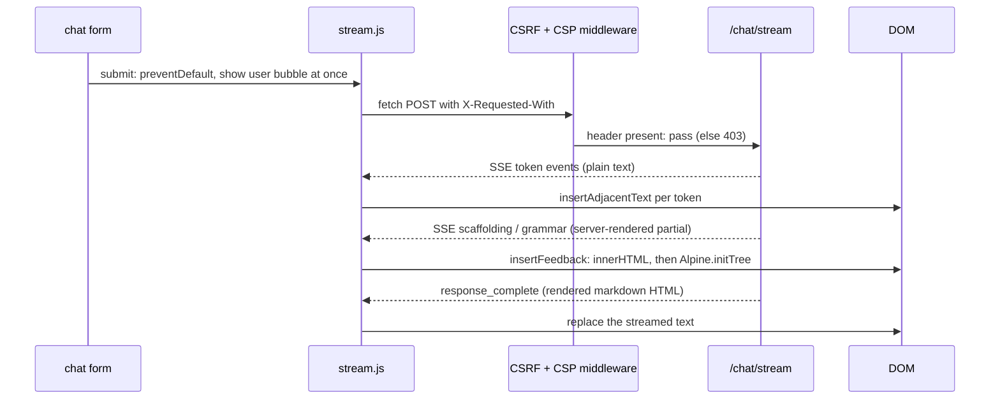
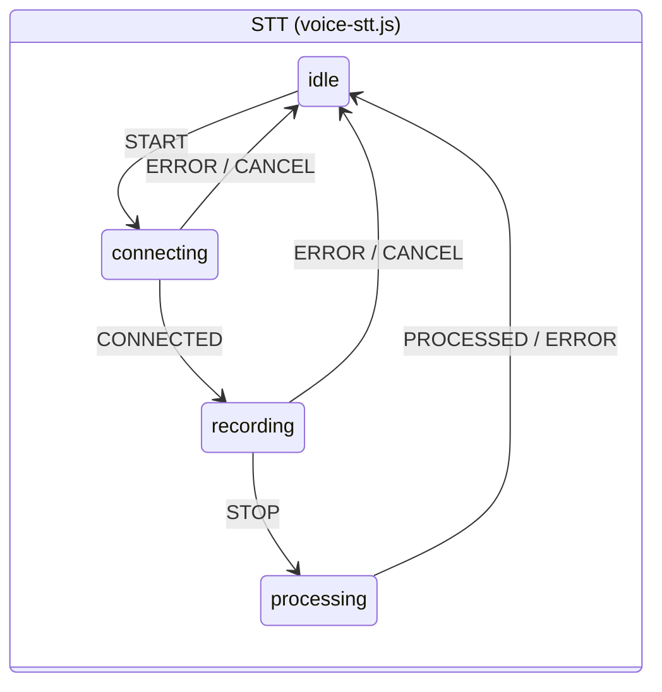

# Walkthrough: a frontend without React

The UI has no React, no bundler and no client state store. The server renders HTML with Jinja2. The browser swaps it in with HTMX, Alpine.js or a few plain ES modules. Logic stays in one language, and the browser holds almost no state that can drift from the server.

## Design

```mermaid
graph LR
    J[Jinja2 page + partials] -- partial HTML --> H[HTMX: hx-post, hx-swap]
    J -- partial HTML inside SSE events --> S[stream.js]
    H -- swap --> D[DOM]
    S -- insert --> D
    S -. Alpine.initTree .-> A[Alpine.js x-data]
    V[voice.js + 2 state machines] -- mic and play buttons --> D
```

| Piece | Used for | Code |
|---|---|---|
| Jinja2 | every page and partial, autoescaped | [base.html scripts](../../src/templates/base.html#L44-L47) |
| HTMX | forms and buttons on auth, review, lessons, progress | [review start button](../../src/templates/partials/review_start.html#L71-L75) |
| `stream.js` | the chat: `fetch` POST plus a hand-written SSE reader | [`streamChat`](../../src/static/js/modules/stream.js#L347-L441) |
| Alpine.js | small local UI state (`x-data`) | |
| `voice.js` | mic and speaker, each as a state machine | [`interpret`](../../src/static/js/modules/voice.js#L240-L242) |

One chat message in the browser:



**Key decisions**

- **Tokens go in as text** ([`appendToken`](../../src/static/js/modules/stream.js#L106-L122)), so a token can never inject markup. Only server HTML goes in through `innerHTML`: Jinja2 partials ([rendered in streaming.py](../../src/api/streaming.py#L146-L175)) and the reply's markdown, which [`render_markdown`](../../src/api/sanitize.py#L100-L115) cleans with nh3.
- **A hand-written SSE parser** ([`parseSSEEvent`](../../src/static/js/modules/stream.js#L52-L68)), because `EventSource` cannot send a POST body.
- **State machines for voice.** [`createMachine`](../../src/static/js/modules/fsm.js#L17-L20) freezes a table of state, event and next state. [`send`](../../src/static/js/modules/fsm.js#L38-L64) ignores an event with no transition (it only warns), so a late callback from a closed socket cannot break the UI.



[`sttMachine`](../../src/static/js/modules/voice-stt.js#L16-L24) is above. [`ttsMachine`](../../src/static/js/modules/voice-tts.js#L23-L30) is smaller: idle, loading (on PLAY), playing (on STREAMING), and back to idle on ALL_ENDED, ERROR or CANCEL.

## Implementation

**The 11 modules.** [main.js](../../src/static/js/main.js#L19-L34) starts `dom`, `stream`, `shortcuts`, `scaffold` and `htmx-handlers`. The chat page loads [voice.js](../../src/templates/chat.html#L222) on its own, and it imports `fsm`, `voice-constants`, `voice-stt`, `voice-tts` and `voice-ui`. There is no build step: the browser loads them as native ES modules.

**CSP nonce.** The middleware makes a fresh nonce for each request and puts it on `request.state` before the route runs ([L153-L155](../../src/api/middleware.py#L153-L155)). Every `<script>` tag carries `nonce="{{ request.state.csp_nonce }}"`. The policy:

```python
# src/api/middleware.py
"default-src 'self'; "
f"script-src 'self' 'nonce-{nonce}' 'unsafe-eval'; "
```

**CSRF by custom header** ([`_has_csrf_header`](../../src/api/middleware.py#L64-L82)). A cross-site form cannot set `HX-Request` or `X-Requested-With` without a CORS preflight, so the header proves the request came from this app's own JS. HTMX adds `HX-Request` itself, and hand-written `fetch` calls add `X-Requested-With`. Without either header, a POST gets 403 ([dispatch](../../src/api/middleware.py#L107-L129)).

**Tests.** Vitest runs in jsdom ([vitest.config.js](../../vitest.config.js#L1-L9)), with 7 files under `tests/js/` (about 250 tests, most in `voice.test.js`). They drive the real modules against a fake DOM, for example [the form submit tests](../../tests/js/stream.test.js#L111). CI runs `npx vitest run` next to pytest ([ci.yml](../../.github/workflows/ci.yml#L150)).

## Gaps

Found while writing this page. Gaps 1 to 4 are fixed; their notes stay as a record.

1. **Fixed: new Hinglish threads got the Spanish flag.** The `thread_created` handler only knew `es`, `de` and `fr`. Now one map, [`LANGUAGE_FLAGS`](../../src/validation.py#L19), feeds the server-rendered rows ([thread_sidebar.html](../../src/templates/partials/thread_sidebar.html#L214)) and reaches the JS through `data-flags` on the list ([L201](../../src/templates/partials/thread_sidebar.html#L201)).
2. **Fixed: the sidebar was found by Tailwind classes.** It is now `#thread-list` ([stream.js](../../src/static/js/modules/stream.js#L298)), and the empty placeholder is `[data-thread-empty]`.
3. **Fixed: the 60 second timeout was for the whole stream.** It is now an idle timeout, reset on every chunk ([L368-L376](../../src/static/js/modules/stream.js#L368-L376), [L397](../../src/static/js/modules/stream.js#L397)), so only a stalled stream shows "timed out".
4. **Kept, on purpose: two places build sidebar HTML.** The server rows carry rename and delete Alpine handlers keyed by thread ID; serving one row would need a new route and a partial. The JS row stays a short copy (no rename or delete until the next load), now with the shared flags and the `thread-title` class, so `thread_title` events rename it (they did not before).
5. **CSP keeps `'unsafe-eval'`** for the standard Alpine build (the code comment says so).

Related: [one chat message](chat-message.md), [voice pipeline](voice-pipeline.md), [security model](security-model.md).
