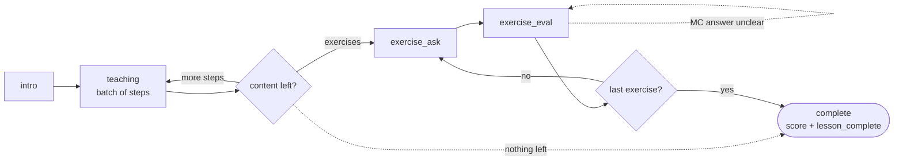
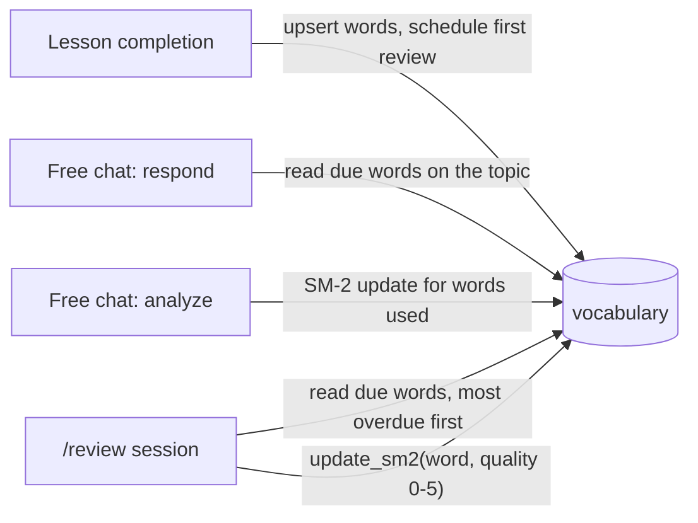

# Walkthrough: lessons and spaced review

Lessons are YAML files. Hermano teaches them inside the normal chat, one phase per turn, so a lesson feels like a conversation and not a form. When a lesson ends, its words enter SM-2 spaced repetition. Due words come back in a review session, and also inside free chat.

Code links point at `main` as of `99cf664`.

## The lesson phase machine

The phase lives in the LangGraph checkpoint as `lesson_phase`. Each POST runs one handler in [lesson_respond_node](../../src/agent/nodes/lesson_chat.py#L528-L543), then saves the next phase.



| Phase | Handler | What it does |
|---|---|---|
| intro | [_handle_intro](../../src/agent/nodes/lesson_chat.py#L170-L201) | Welcome, then move to teaching |
| teaching | [_handle_teaching](../../src/agent/nodes/lesson_chat.py#L242-L259) | Present a batch of steps, pick the next phase |
| exercise_ask | [_handle_exercise_ask](../../src/agent/nodes/lesson_chat.py#L277-L316) | Show the current exercise |
| exercise_eval | [_handle_exercise_eval](../../src/agent/nodes/lesson_chat.py#L338-L365) | Grade: multiple choice and fill-blank in code, translate by the LLM |
| complete | [_handle_complete](../../src/agent/nodes/lesson_chat.py#L448-L511) | Final score and the `lesson_complete` event |

The [lesson graph](../../src/agent/lesson_chat_graph.py#L24-L42) keeps the chat graph shape (respond, scaffold, analyze), so SSE streaming works the same for lessons and free chat.

## Where lesson words go

All SM-2 state lives on the `vocabulary` table ([migration](../../migrations/001_spaced_repetition.sql#L8-L13)): `easiness_factor` (default 2.5), `interval_days`, `repetition_count`, `next_review_at`.



- Lesson ends: [initialize_lesson_vocabulary_for_review](../../src/services/lesson_completion.py#L160-L176)
- Chat weaving, read: [respond_node](../../src/agent/nodes/respond.py#L210-L225) adds due words to the prompt
- Chat weaving, write: [analyze](../../src/agent/nodes/analyze.py#L249-L256) grades the words the learner used
- Review session: [get_due_words](../../src/api/routes/review.py#L349), then [_evaluate_answer and update_sm2](../../src/api/routes/review.py#L363-L369)

## Call path: the learner opens `/?lesson=<id>`

1. [GET /](../../src/api/routes/chat.py#L351-L365) with `?lesson=<id>`
   - [_lesson_page_context](../../src/api/routes/chat.py#L415-L429): 404 for an unknown lesson, a new `lesson_session` UUID per page load
   - [LessonService.get_lesson](../../src/lessons/service.py#L353-L356): YAML is loaded once with [rglob](../../src/lessons/service.py#L75-L82)
2. [POST /chat/stream](../../src/api/routes/chat_stream.py#L126-L128) with `lesson_id`
   - [thread_id](../../src/api/routes/chat_stream.py#L202-L206) is `lesson:<who>:<lesson>:<attempt>` ([format](../../src/api/routes/chat.py#L144-L149)), so each attempt gets a clean checkpoint
   - [_stream_lesson_turn](../../src/api/routes/chat_stream.py#L278-L298): the lesson state is sent only on the first turn; later turns resume from the checkpoint
   - [lesson_respond_node](../../src/agent/nodes/lesson_chat.py#L528-L543): dispatch on `lesson_phase`
   - [_lesson_state_events](../../src/api/routes/chat_stream.py#L318-L340): `lesson_progress`, `exercise_result`, `lesson_complete`
   - [_persist_lesson_completion](../../src/api/routes/chat_stream.py#L343-L357), signed-in users only
   - [complete_lesson_and_persist](../../src/services/lesson_completion.py#L189-L214): progress row, then words into review

## Key snippets

SM-2 ([review.py](../../src/services/review.py#L247-L265)): quality 3 or more grows the interval (1 day, 6 days, then times easiness). A miss resets it to 1 day. Easiness never drops below 1.3.

```python
if quality >= 3:  # Successful recall
    if repetition_count == 0:
        interval_days = 1
    elif repetition_count == 1:
        interval_days = 6
    else:
        interval_days = round(interval_days * easiness_factor)
    repetition_count += 1
else:  # Failed recall - reset
    repetition_count = 0
    interval_days = 1

easiness_factor = max(
    1.3,
    easiness_factor + (0.1 - (5 - quality) * (0.08 + (5 - quality) * 0.02)),
)
```

Translate exercises ([lesson_chat.py](../../src/agent/nodes/lesson_chat.py#L143-L162)): the LLM grades the answer and starts its reply with `[CORRECT]` or `[INCORRECT]`. The tag is stripped. With no tag, plain string matching decides.

## Worth knowing

- The `/review` routes call `ReviewService` directly. An unused LangGraph review subgraph was removed.
- Lesson completion is saved only for signed-in users, by design: guests have no progress page. Guests can finish a lesson, but no progress row or review words are written.
- Words are woven into chat only in free chat: the lesson graph uses its own respond node.
