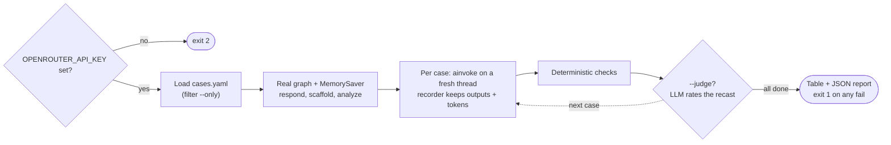

# Walkthrough: LLM evals

Unit tests mock the model, so they cannot show how Hermano behaves with a real LLM. `make eval` sends 20 single-turn learner messages through the real chat graph and scores each reply with deterministic checks. It found a real bug: hidden reasoning used up `max_tokens` and cut the analyze node's JSON short.

Full check table and run commands: [testing.md](../testing.md#llm-evals).

## One eval run



Decisions:

- **Deterministic checks first.** They are pure functions, so CI unit tests them with no network. The LLM judge is optional (`--judge`).
- **Real graph, not a prompt in isolation.** A case runs respond, scaffold and analyze exactly as in production, so node wiring and JSON parsing are tested too.
- **Sequential cases.** Latency numbers stay honest and rate limits stay low.

## Call path

1. [`make eval`](../../Makefile#L51-L53) runs `uv run python -m evals.run`.
2. [`main`](../../evals/run.py#L189-L213) checks the key, builds the graph with `MemorySaver`, runs the cases, prints the table and writes the report.
3. [`run_cases`](../../evals/run.py#L128-L132) runs cases one after another.
4. [`run_case`](../../evals/run.py#L92-L125) invokes the graph on thread `eval-<id>` with a [`_Recorder`](../../evals/run.py#L53-L70) callback that keeps every LLM output and token count.
5. [`score_case`](../../evals/scoring.py#L154-L172) runs the checks that apply, including [`check_json_outputs`](../../evals/scoring.py#L113-L122) on the scaffold and analyze outputs.
6. [`case_passed`](../../evals/scoring.py#L175-L177): a case passes when no check failed. Skipped checks do not count.

## Key snippets

One case ([cases.yaml](../../evals/cases.yaml#L24-L30)). Analyze must return feedback, the reply must not lecture, and it must model "soy" or "eres":

```yaml
  - id: es-a1-ser-error
    language: es
    level: A1
    message: "Yo es estudiante y me gusta la música."
    expect:
      grammar_error: true
      recast: ["soy", "eres"]
```

Language mix bands per CEFR level ([scoring.py](../../evals/scoring.py#L21-L28)). Wide on purpose, because the stopword heuristic is crude:

```python
LEVEL_BANDS: dict[str, tuple[float, float]] = {
    "A0": (0.05, 0.5),
    "A1": (0.2, 0.8),
    "A2": (0.55, 1.0),
    "B1": (0.8, 1.0),
}
```

## Results: the bug it caught

| Run (2026-11-14, `anthropic/claude-haiku-5.5`) | Pass rate | Time | Output tokens |
|---|---|---|---|
| Before #122 | 9/20 | 191s | 31.7k |
| After #122 | 20/20 | 117s | 15.9k |

Hidden reasoning used about 440 of the 1024 `max_tokens` on the analysis profile. The analyze JSON was cut off, so grammar feedback was silently empty. The fix in [`get_llm`](../../src/agent/llm.py#L91-L94) turns reasoning off for every profile:

```python
extra_body: dict[str, Any] = {"reasoning": {"enabled": False}}
```

## Limits

- Only 20 single-turn cases. Multi-turn behaviour is not tested.
- The real eval never runs in CI or `make test`: it needs `OPENROUTER_API_KEY` and costs money (about 1 US cent per run). CI only covers the scorer and runner in `tests/evals/` with a fake chat model.
- `language_mix` uses stopwords, so it is a rough signal with wide bands.
