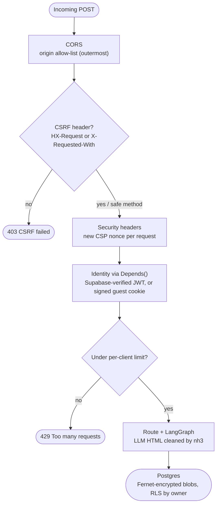

# Security model

Habla Hermano keeps learner conversations private. Guests use the app with no account, so the server trusts only identities it signed itself. This page follows one POST request through each layer, then shows how data is protected at rest and in traces.

## A POST request through the layers



Starlette makes the last added middleware the outermost one, so the request order is CORS, CSRF, SecurityHeaders, ProxyHeaders ([main.py](../../src/api/main.py#L157-L180)). FastAPI resolves dependencies before the endpoint runs, and the rate limiter wraps the endpoint, so identity is resolved before the rate check.

## The layers

| Layer | What it stops | Code |
|---|---|---|
| CORS | Other origins calling the API with credentials | [CORSMiddleware](../../src/api/main.py#L163-L180) |
| CSRF (custom header) | Cross-site form posts: they cannot set `HX-Request` | [CSRFMiddleware.dispatch](../../src/api/middleware.py#L107-L129) |
| CSP with nonce | Injected `<script>` tags without the per-request nonce | [SecurityHeadersMiddleware](../../src/api/middleware.py#L153-L185) |
| JWT auth | Forged account tokens: Supabase verifies them server-side | [OptionalUserDep](../../src/api/auth.py#L421), [_verify_token_via_supabase](../../src/api/auth.py#L185) |
| Signed guest cookie | Forged guest IDs such as `user:<someone's uuid>` | [verified_session_cookie](../../src/api/cookies.py#L180-L187) |
| Per-client rate limit | One caller using up everyone's budget | [client_key](../../src/api/rate_limit.py#L44-L56), [rate_limited](../../src/api/rate_limit.py#L59-L92) |
| nh3 sanitization | Script or event handlers in LLM-generated HTML | [sanitize_html](../../src/api/sanitize.py#L56-L72) |
| Fernet encryption | Readable data in a leaked database dump | [encryption.py](../../src/db/encryption.py#L24-L57), [EncryptedSerializer](../../src/agent/checkpointer.py#L53-L61) |
| Row-level security | One user reading another user's checkpoints | [004_checkpoint_rls.sql](../../migrations/004_checkpoint_rls.sql#L29-L55) |
| Trace masking | Learner text reaching Langfuse | [mask_content](../../src/services/tracing.py#L41-L57) |

## Key snippets

The guest trust boundary. Guest data is keyed by the raw cookie value, so it is accepted only with a valid itsdangerous signature:

```python
def verified_session_cookie(raw_value: str | None) -> str | None:
    return raw_value if unsign_session_id(raw_value) else None
```

The rate-limit key. Render's proxy appends the real client IP as the last `X-Forwarded-For` entry; earlier entries come from the client and can be forged:

```python
forwarded = request.headers.get("x-forwarded-for")
if forwarded:
    return forwarded.rsplit(",", 1)[-1].strip()
return request.client.host if request.client else "-"
```

Row-level security. The owner UUID is the second part of `thread_id` (`user:<uuid>`), and it must equal `auth.uid()`. The server's service role bypasses RLS for guests and admin work:

```sql
CREATE POLICY checkpoints_user_policy ON checkpoints
  FOR ALL
  USING (checkpoint_owner(thread_id) = auth.uid())
  WITH CHECK (checkpoint_owner(thread_id) = auth.uid());
```

## WebSockets

WebSockets do not pass the CSRF check. The [voice handshake](../../src/api/routes/voice.py#L113-L180) accepts a Supabase-verified JWT, a signed guest cookie, or a signed `token` query value (WebKit may drop cookies on the upgrade). Otherwise it closes with code 1008. Each TTS socket gets its own [message limiter](../../src/api/routes/voice.py#L470).

## Known gaps

- CSP keeps [`'unsafe-eval'`](../../src/api/middleware.py#L169-L171) for the standard Alpine.js build. Removing it means `@alpinejs/csp` and registering each component with `Alpine.data()`.
- Rate-limit state is a [dict per process](../../src/api/rate_limit.py#L72-L81). With several workers, each worker has its own budget, and the dict clears at 10,000 clients.
