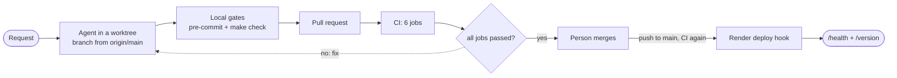

# Walkthrough: the software factory

How a change travels from an idea to production. Most changes start as a request to a coding agent (Claude Code), which works in its own git worktree and opens a PR. Checks then catch bad changes: local hooks, six CI jobs, a CI success gate, and a health check after deploy.

## Design



| Stage | What runs | Code |
|---|---|---|
| Agent recipes | 11 repo skills: add a route, node, lesson, test; run checks | [.claude/skills/](../../.claude/skills/) |
| Local gates | pre-commit (ruff, mypy, secret and large-file checks), `make check` | [.pre-commit-config.yaml](../../.pre-commit-config.yaml), [Makefile](../../Makefile) |
| CI | lint, typecheck, test with 88% coverage floor, JS tests + stale CSS check, Bandit, Docker build | [ci.yml](../../.github/workflows/ci.yml) |
| Gate | `ci-success` fails if any job did not succeed | [ci-success](../../.github/workflows/ci.yml#L224-L242) |
| Deploy | Render deploy hook, push to main only, after every job | [deploy](../../.github/workflows/ci.yml#L252-L280) |
| Verify | Render polls `/health`; `/version` names the deployed commit | [main.py](../../src/api/main.py) |
| Manual | `make eval` against the real model before prompt or model changes | [Makefile](../../Makefile) |

**Key decisions**

- **Agents write, people merge.** Agent output gets the same checks as human code, and a person merges each PR.
- **One worktree per task.** Parallel agents never touch the same checkout or someone's uncommitted work.
- **Repo skills as recipes.** They keep agent changes in the house style.
- **The CI hook deploys only after every job passes.**

## Implementation

The checks that turn CI red:

```yaml
# .github/workflows/ci.yml: Tailwind is compiled and committed; stale CSS fails CI (#121)
- name: Check built Tailwind CSS is up to date
  run: |
    npm run build:css
    git diff --exit-code src/static/css/styles.css || { ...; exit 1; }
```

```toml
# pyproject.toml: coverage floor (#118)
fail_under = 88
```

```yaml
# .github/workflows/ci.yml: deploy only after all six jobs, on push to main
deploy:
  needs: [lint, typecheck, test, test-js, security, build]
  if: github.event_name == 'push' && github.ref == 'refs/heads/main'
  concurrency: { group: render-deploy, cancel-in-progress: false }
```

## Gaps (checked 2026-11-15)

- **main is not protected.** The GitHub API reports "Branch not protected" and no rulesets, so a red CI run does not block a merge. Making `CI Success` a required check closes this.
- **Render autoDeploy is still on** in [render.yaml](../../render.yaml#L28-L32), so Render can deploy every push to main without waiting for CI, and the hook adds a second deploy. The dashboard setting was not checked.
- **Docs-only pushes skip CI** because of path filters, so they also skip the hook deploy.
- **Evals are manual.** No CI job runs `make eval`.
