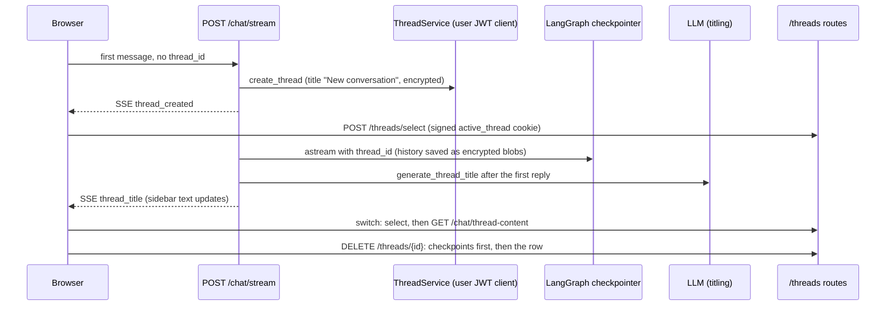

# Walkthrough: threads and the data lifecycle

A signed-in learner can keep many conversations (threads), each with its own language and level. This page follows one thread from creation to deletion, and shows what the app stores, what it encrypts, and what it deletes.

Two stores hold a thread:

- The [`conversation_threads`](../../migrations/005_conversation_threads.sql#L13-L32) table holds metadata: title, language, level, timestamps.
- The LangGraph checkpoint tables hold the messages.

The `thread_id` string joins them: `user:{user_id}:{uuid4}` ([`create_thread`](../../src/services/threads.py#L56-L72)).

## Design



What is stored where:

| Data | Table | Encrypted? | Code |
|---|---|---|---|
| Thread title | `conversation_threads.title` | Yes, Fernet | [create](../../src/services/threads.py#L61-L70), [rename](../../src/services/threads.py#L102-L111) |
| Language, level, timestamps | `conversation_threads` | No | same |
| Messages and graph state | `checkpoints`, `checkpoint_blobs`, `checkpoint_writes` | Yes, `EncryptedSerializer` | [`_get_encrypted_serde`](../../src/agent/checkpointer.py#L53-L61) |
| Display name | `user_profiles.display_name` | Yes | [repository](../../src/db/repository.py#L74) |
| Word translations | `vocabulary.translation` | Yes (the word itself is plain) | [repository](../../src/db/repository.py#L223-L231) |

The Fernet key comes from PBKDF2 over `SECRET_KEY` and `ENCRYPTION_SALT` ([`_derive_key`](../../src/db/encryption.py#L24-L41)), so changing either one makes old rows unreadable.

**Key decisions**

- **The active thread is in a signed cookie, not the URL.** [`select_thread`](../../src/api/routes/threads.py#L130-L145) checks ownership, then signs `{"tid": ...}`. The thread ID stays out of URLs, browser history and referrer headers.
- **Ownership is checked twice.** The route asks [`get_thread`](../../src/services/threads.py#L88-L100) with `user_id`, and RLS on the table checks the JWT again. A message to a thread you do not own gets no identity ([C1 check](../../src/api/routes/chat.py#L262-L264)).
- **Delete removes checkpoints before the row.** If a step fails, the row stays, so a retry can finish ([`delete_thread`](../../src/services/threads.py#L133-L155)).

## Implementation

Page load, when the learner comes back:

1. `GET /` reads the [`active_thread` cookie](../../src/api/routes/chat.py#L362) and calls [`_thread_page_context`](../../src/api/routes/chat.py#L433-L461).
2. [`unsign_active_thread`](../../src/api/cookies.py#L190-L205) returns `None` for a missing or forged cookie.
3. [`_is_valid_thread_id`](../../src/api/routes/chat.py#L80-L95) rejects odd formats before they reach the database.
4. [`ThreadService.get_thread`](../../src/services/threads.py#L88-L100) loads the row (owner filter plus RLS), and [`_decrypt_title`](../../src/services/threads.py#L25-L38) falls back to plain text for rows written before encryption.

First message in a new thread:

1. [`_resolve_freeform_identity`](../../src/api/routes/chat.py#L262-L270) creates the thread when the form has no `thread_id`.
2. The stream sends [`thread_created`](../../src/api/routes/chat_stream.py#L225-L231); the browser stores the ID in the form and [calls `/threads/select`](../../src/static/js/modules/stream.js#L286-L290).
3. After the first reply, [`_auto_title_thread`](../../src/api/routes/chat_stream.py#L360-L379) asks the LLM for a 3 to 5 word title ([`generate_thread_title`](../../src/services/thread_titling.py#L21-L43)) and sends `thread_title` to the sidebar.

RLS on the checkpoint tables takes the owner from the second segment of `thread_id`:

```sql
-- migrations/004_checkpoint_rls.sql
CREATE OR REPLACE FUNCTION checkpoint_owner(thread_id TEXT)
RETURNS UUID LANGUAGE sql IMMUTABLE PARALLEL SAFE AS $$
  SELECT split_part(thread_id, ':', 2)::UUID
$$;
```

Guest threads have no UUID there. The server reaches them with the service role, which bypasses RLS.

Deleting data:

| Action | What goes | Code |
|---|---|---|
| Delete one thread | its checkpoint rows, then its metadata row | [`delete_thread`](../../src/services/threads.py#L133-L155) |
| Delete all conversations | every `user:{id}:%` and `lesson:{id}:%` checkpoint, all thread rows | [privacy route](../../src/api/routes/privacy.py#L73-L97) |
| Delete account | vocabulary, sessions, lesson progress, checkpoints (shared [`delete_user_rows`](../../src/services/user_data.py#L12-L32)), then the auth user (cascades profile and threads) | [privacy route](../../src/api/routes/privacy.py#L139-L149) |
| Daily purge | every conversation whose last message is older than `CHECKPOINT_RETENTION_DAYS` (30): its checkpoints, blobs, writes and thread row, in one transaction | [`purge_old_checkpoints`](../../src/agent/checkpoint_purge.py#L30-L67), run at startup and then every 24 hours by [`_purge_daily`](../../src/api/main.py#L71-L74) |

## Gaps

Found while writing this page. Gaps 1 to 3 are fixed; their notes stay as a record.

1. **Fixed: the startup checkpoint purge deleted nothing.** [`purge_old_checkpoints`](../../src/agent/checkpoint_purge.py#L49-L58) filters on `thread_ts`, but the installed `langgraph-checkpoint-postgres` tables have no such column (no timestamp column at all). The error is caught and logged, so startup goes on and the 30-day retention never runs. Tests mock the connection, so they pass.
2. **Fixed (removed): `purge_old_conversations` was never called.** `data_retention.py` had no caller in `src/`, and it uses the anon client, so RLS would block its deletes anyway. It also deleted learning sessions and vocabulary (progress), not chat history. The function and `CONVERSATION_RETENTION_DAYS` are gone; chat retention is the daily purge above, now tested against a real Postgres in CI.
3. **Fixed: guest rows broke signed-in deletes.** Guest threads use a bare session UUID, so `checkpoint_owner()` cast `''` to UUID and raised. Reproduced on Postgres 16: with one guest row present, "Delete all conversations" failed (caught and logged) and deleted nothing. [Migration 007](../../migrations/007_checkpoint_owner_guest_safe.sql) casts only well-formed UUIDs; [test_checkpoint_owner_sql.py](../../tests/db/test_checkpoint_owner_sql.py) runs the real migrations as a signed-in user.
4. **Thread switch ignores a failed select.** The sidebar loads `/chat/thread-content` even if `/threads/select` returned 404, because `fetch` does not reject on HTTP errors ([sidebar](../../src/templates/partials/thread_sidebar.html#L39-L40)).

Related: [security model](security-model.md), [one chat message](chat-message.md).
