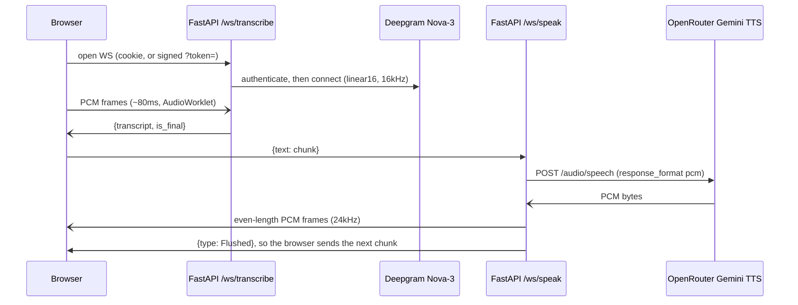
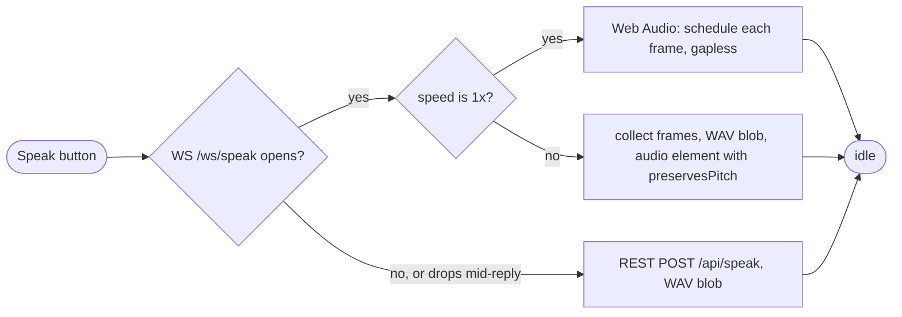

# Voice pipeline

Learners can speak to Hermano and hear each reply.

- **Speech to text (STT):** the browser streams mic audio over a WebSocket. FastAPI forwards it to Deepgram Nova-3.
- **Text to speech (TTS):** FastAPI streams Gemini TTS audio from OpenRouter back over a second WebSocket. A REST endpoint is the fallback when that socket fails.

Line links point at commit `99cf664`.

## Speak, then listen



Code for each step:

- [new WebSocket](../../src/static/js/modules/voice-stt.js#L168) opens the STT socket.
- The [Deepgram connect](../../src/api/routes/voice.py#L291-L303) uses linear16 at 16kHz.
- The [audio forwarding loop](../../src/api/routes/voice.py#L342-L344) passes frames to Deepgram, and the [transcript relay](../../src/api/routes/voice.py#L318-L327) sends text back.
- The [first TTS chunk](../../src/static/js/modules/voice-tts.js#L210-L220) is sent when the socket opens.
- [_speak_text](../../src/api/routes/voice.py#L426-L436) forwards the frames, then sends `Flushed`.

## How the browser plays a reply



- [onclose fallback](../../src/static/js/modules/voice-tts.js#L322-L338) switches to REST if the socket never opened or closed mid-reply.
- [bufferedFrames](../../src/static/js/modules/voice-tts.js#L148-L152) decides whether to stream or to buffer.
- [Gapless scheduling](../../src/static/js/modules/voice-tts.js#L247-L249) plays the frames back to back.
- [preservesPitch](../../src/static/js/modules/voice-tts.js#L359-L363) keeps the pitch when the speed changes.

## Key decisions

- **Proxy through FastAPI.** The browser never sees the Deepgram or OpenRouter key. The server checks identity before `accept()`.
- **Raw PCM, not MP3.** Gemini TTS gives 24kHz 16-bit PCM. At 1x the browser plays each frame as it arrives, so the first word comes early.
- **Pitch at other speeds (#110).** Web Audio changes speed like tape, so the pitch drops. At any other speed the browser waits for the whole reply. It then plays it through `<audio>` with `preservesPitch`.
- **Rate limits.** See the [constants](../../src/api/rate_limit.py#L25-L32).
  - REST `/api/speak`: 10 calls per minute per client.
  - `/ws/speak`: 30 text messages per minute per connection.
  - STT frames: no per-message limit; the authenticated socket is the throttle.

## Call path: Speak button to audio

1. [handleSpeakClick](../../src/static/js/modules/voice.js#L357-L394) clamps the speed to 0.25x to 2x and moves the TTS machine to `loading`.
2. [audioElementTTS](../../src/static/js/modules/voice-tts.js#L94) handles the iOS audio session, then starts the WebSocket path.
3. [doWebSocketTTS](../../src/static/js/modules/voice-tts.js#L133-L152) splits the text into chunks and opens `/ws/speak`.
4. [speak_stream](../../src/api/routes/voice.py#L458-L471) checks identity and voice before `accept()`, then creates the per-connection limiter.
5. The [message loop](../../src/api/routes/voice.py#L483-L500) validates the text and checks the limiter. It answers every message, because the browser waits for a reply before it sends the next chunk.
6. [_speak_text](../../src/api/routes/voice.py#L426-L436) forwards PCM frames, then sends `Flushed`.
7. [synthesize_pcm](../../src/services/tts.py#L47-L94) streams the audio from OpenRouter, with zero data retention when it is enabled.
8. The browser's [onmessage](../../src/static/js/modules/voice-tts.js#L240-L256) schedules each frame, or buffers it when the speed is not 1x.

## Snippets worth reading

**Whole samples only** ([tts.py](../../src/services/tts.py#L83-L89)). The browser decodes each frame with `new Int16Array(buffer)`, which throws on an odd byte length. So an odd trailing byte is carried over to the next chunk:

```python
carry = b""
async for chunk in response.aiter_bytes():
    data = carry + chunk
    usable = len(data) - (len(data) % _BYTES_PER_SAMPLE)
    carry = data[usable:]
    if usable:
        yield data[:usable]
```

**Clean REST errors** ([voice.py](../../src/api/routes/voice.py#L394-L403)). The route pulls the first chunk before it answers, so an upstream failure becomes a 502. Without this, the client would get a 200 that breaks halfway.

**State machines** ([STT](../../src/static/js/modules/voice-stt.js#L16-L24), [TTS](../../src/static/js/modules/voice-tts.js#L23-L30)). Both are small state machines built on `fsm.js`.

| Machine | States |
|---|---|
| STT | `idle`, `connecting`, `recording`, `processing` |
| TTS | `idle`, `loading`, `playing` |

Every `ERROR` or `CANCEL` goes back to `idle`.
